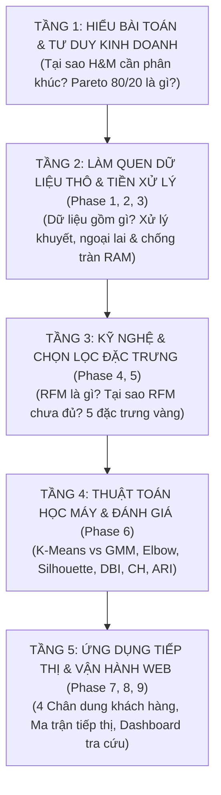
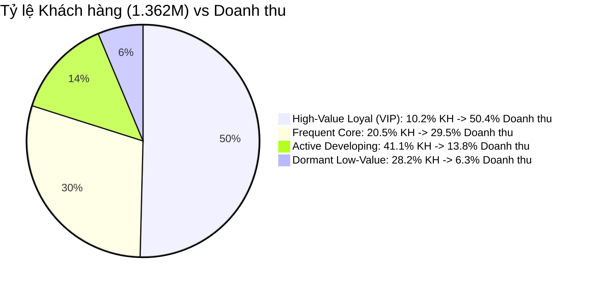

# CẨM NANG ÔN TẬP & LỘ TRÌNH LÀM QUEN PHÂN TÍCH DỮ LIỆU TỪ SỐ 0 ĐẾN MASTER
## Dự án: Phân Khúc Khách Hàng H&M Hỗ Trợ Ra Quyết Định Tiếp Thị (CRISP-DM 9-Phase)

---

> [!NOTE]
> **Mục tiêu của tài liệu này:**  
> Dành cho người mới bắt đầu làm quen với phân tích dữ liệu (Data Analysis / Data Mining). Tài liệu này được biên soạn như một cuốn **"bản đồ chỉ đường"** chi tiết từng bước, giúp bạn hiểu cội nguồn từ dữ liệu thô, lý do tại sao lại chọn công thức/thuật toán đó, cách đọc từng biểu đồ, thứ tự các file cần xem, và bộ câu hỏi vấn đáp giúp bạn tự tin 100% khi bảo vệ đồ án.

---

## 🗺️ PHẦN 1: BẢN ĐỒ LỘ TRÌNH 5 TẦNG HỌC TẬP (STUDY ROADMAP)

Để không bị ngợp trước khối lượng dữ liệu khổng lồ (31.78 triệu giao dịch), bạn hãy đi theo **5 Tầng Nhận Thức** từ dễ đến khó sau đây:



---

## 🧭 PHẦN 2: THỨ TỰ ĐỌC FILE DÀNH CHO BẠN (READING ORDER)

Đừng mở file ngẫu nhiên! Hãy mở và đọc theo đúng thứ tự 4 bước sau:

| Thứ tự | Tên File / Thư mục | Mục đích đọc | Bạn cần nắm được gì sau khi đọc? |
| :---: | :--- | :--- | :--- |
| **Bước 1** | [README.md](file:///c:/Users/Dell/Project/README.md) | Nắm bức tranh tổng thể dự án trong 5 phút | 4 nhóm khách hàng là ai, đóng góp bao nhiêu % doanh thu, các lệnh chạy web app. |
| **Bước 2** | [methodology_summary.md](file:///c:/Users/Dell/Project/reports/final/methodology_summary.md) & [final_findings.md](file:///c:/Users/Dell/Project/reports/final/final_findings.md) | Xem câu trả lời cho 7 câu hỏi nghiên cứu (RQ1–RQ7) | Hiểu kết luận khoa học của từng giai đoạn mà không cần đọc code phức tạp. |
| **Bước 3** | Thư mục [notebooks/](file:///c:/Users/Dell/Project/notebooks) (Từ Phase 1 đến Phase 9) | Xem chi tiết code, biến đổi dữ liệu và vẽ biểu đồ | Hiểu cách dữ liệu biến đổi từ file thô CSV $\rightarrow$ Parquet $\rightarrow$ Cụm $\rightarrow$ Chiến lược. |
| **Bước 4** | Chạy [web_app.py](file:///c:/Users/Dell/Project/web_app.py) (`python web_app.py`) | Trải nghiệm giao diện trực quan | Tự tay nhập thử thông số R-F-M để xem mô hình phân cụm khách hàng như thế nào. |

---

## 📚 PHẦN 3: CHI TIẾT TỪNG TẦNG KIẾN THỨC (TỪ CƠ BẢN ĐẾN CHUYÊN SÂU)

---

### 🟢 TẦNG 1: HIỂU BÀI TOÁN KINH DOANH (BUSINESS CONTEXT)

#### 1. Bài toán thực tế của H&M là gì?
H&M có hơn **1.36 triệu khách hàng** mua sắm với **105 nghìn sản phẩm**. 
- Nếu gửi cùng 1 email khuyến mãi giảm giá 20% cho tất cả mọi người $\rightarrow$ Khách VIP (sẵn sàng mua giá gốc) cũng được giảm giá (lỗ biên lợi nhuận), còn khách đã bỏ đi 2 năm thì không thèm mở mail (tốn chi phí marketing vô ích).
- **Giải pháp:** *Phân khúc khách hàng (Customer Segmentation)* — chia 1.36 triệu khách thành các nhóm có hành vi tương đồng để áp dụng chiến lược marketing riêng biệt.

#### 2. Quy luật Pareto 80/20 trong dự án này là gì?
- Trong kinh doanh: 80% doanh thu thường đến từ 20% khách hàng trung thành nhất.
- Trong dữ liệu H&M thực tế của nhóm:
  - **Top 10.2% khách hàng VIP (`High-Value Loyal`)** mang về tới **50.38% doanh thu**!
  - **Top 30.7% khách hàng (`VIP + Core`)** mang về tới **79.89% doanh thu** (trùng khớp kỳ diệu với quy luật 80/20).
  - Gần 70% khách hàng còn lại chỉ đóng góp 20% doanh thu.

---

### 🟡 TẦNG 2: LÀM QUEN DỮ LIỆU & TIỀN XỬ LÝ (PHASE 1, 2, 3)

#### File cần xem:
- [Customer_Segmentation_HM_Phase1_Audit.ipynb](file:///c:/Users/Dell/Project/notebooks/Customer_Segmentation_HM_Phase1_Audit.ipynb)
- [Customer_Segmentation_HM_Phase2_Cleaning.ipynb](file:///c:/Users/Dell/Project/notebooks/Customer_Segmentation_HM_Phase2_Cleaning.ipynb)
- [Customer_Segmentation_HM_Phase3_EDA.ipynb](file:///c:/Users/Dell/Project/notebooks/Customer_Segmentation_HM_Phase3_EDA.ipynb)

#### Kiến thức nền tảng cần nhớ:
1. **Dữ liệu thô gồm 3 bảng chính:**
   - `transactions_train.csv` (31.78 triệu dòng, 3.3 GB): Nhật ký từng món đồ được mua (ngày mua `t_dat`, ai mua `customer_id`, mua đồ gì `article_id`, giá bao nhiêu `price`, kênh online hay offline `sales_channel_id`).
   - `customers.csv` (1.37 triệu dòng): Tuổi (`age`), trạng thái hội viên (`club_member_status`), tần suất nhận tin (`fashion_news_frequency`).
   - `articles.csv` (105 nghìn dòng): Tên loại quần áo (`product_type_name`), nhóm may mặc (`garment_group_name`), màu sắc (`colour_group_name`).

2. **Các thử thách kỹ thuật & cách nhóm giải quyết:**
   - **Thử thách 1 (Tràn RAM máy cá nhân):** Đọc 31 triệu dòng bằng Pandas sẽ tốn 10–16GB RAM $\rightarrow$ Crash máy!
     - *Cách giải quyết:* Sử dụng **DuckDB** với lệnh giới hạn `SET max_memory = '2.5GB'`, sau đó lưu dưới định dạng nén **Parquet** (nhanh gấp 10 lần và nhẹ hơn 80% so với CSV).
   - **Thử thách 2 (Rò rỉ dữ liệu - Data Leakage):** 
     - Không thể lấy dữ liệu mua hàng trong tương lai để đi phân cụm cho quá khứ. Nhóm chốt mốc thời gian cứng: `SNAPSHOT_DATE = 2020-09-22`.
   - **Thử thách 3 (Dữ liệu khuyết và ngoại lai - Outliers):**
     - Khuyết tuổi (`age` khuyết ~1.1%): Điền bằng trung vị (`median`) theo giới tính.
     - Giá tiền (`price`): Cắt tỉa (Capping) ở phân vị 99.9% để tránh các giao dịch bất thường bóp méo mô hình.

---

### 🟠 TẦNG 3: KỸ NGHỆ & CHỌN LỌC ĐẶC TRƯNG (PHASE 4, 5)

#### File cần xem:
- [Customer_Segmentation_HM_Phase4_RFM_Extended_Features.ipynb](file:///c:/Users/Dell/Project/notebooks/Customer_Segmentation_HM_Phase4_RFM_Extended_Features.ipynb)
- [Customer_Segmentation_HM_Phase5_Feature_Selection.ipynb](file:///c:/Users/Dell/Project/notebooks/Customer_Segmentation_HM_Phase5_Feature_Selection.ipynb)

#### 1. RFM cổ điển là gì?
- **R (Recency):** Số ngày kể từ lần mua gần nhất đến mốc hiện tại. (Càng nhỏ $\rightarrow$ Mới mua gần đây $\rightarrow$ Càng tốt).
- **F (Frequency):** Số ngày phát sinh mua hàng trong 2 năm. (Càng lớn $\rightarrow$ Mua thường xuyên $\rightarrow$ Càng tốt).
- **M (Monetary):** Tổng số tiền đã chi tiêu. (Càng cao $\rightarrow$ Khách sắm nhiều $\rightarrow$ Càng tốt).

#### 2. Tại sao RFM cổ điển "CHƯA ĐỦ" cho thời trang? (Nghiên cứu RQ1 & RQ2)
Thời trang không giống như mua nước mắm hay bột giặt. Hai khách hàng cùng chi \$500 và mua 5 lần:
- Khách A: Chỉ mua duy nhất quần jeans đen.
- Khách B: Mua cả váy dạ hội, đồ bơi, áo sơ mi công sở, phụ kiện phối màu phong phú.
$\rightarrow$ Khách B là tín đồ thời trang (Fashionista), gu thẩm mỹ rộng, cần chiến dịch gợi ý sản phẩm hoàn toàn khác khách A!

Vì vậy, nhóm tạo ra **Extended Features (Đặc trưng mở rộng)**:
- `product_diversity`: Số lượng sản phẩm khác nhau từng mua.
- `product_type_diversity`: Số loại quần áo khác nhau trong tủ đồ.
- `garment_group_diversity`: Số nhóm may mặc khác nhau.
- `mean_interpurchase_days`: Khoảng cách trung bình giữa các lần mua (nhịp độ mua).

#### 3. Tại sao từ 21 biến nhóm chỉ chọn 5 biến cuối cùng? (Feature Selection)
Nếu cho hết 21 biến vào thuật toán phân cụm, bạn sẽ gặp tai họa gọi là **"Lời nguyền số chiều" (Curse of Dimensionality)** — các biến bị trùng lặp thông tin (ví dụ: đã có `product_diversity` lại thêm `article_count` thì gần như là một) làm khoảng cách Euclid bị nhiễu.

Nhóm dùng **Consensus Ranking (Đồng thuận 3 phương pháp)**:
1. **ANOVA F-test:** Đo lường sự khác biệt trung bình giữa các nhóm.
2. **Mutual Information (Thông tin tương hỗ):** Bắt các mối quan hệ phi tuyến tính.
3. **Random Forest Feature Importance:** Đo mức độ đóng góp của biến khi dự đoán hành vi tương lai.

**Kết quả chọn ra "Bộ ngũ vàng" (Final 5 Features):**
1. `recency_days` (R)
2. `frequency_purchase_days` (F)
3. `monetary_total_spend` (M)
4. `product_diversity` (Đa dạng sản phẩm)
5. `product_type_diversity` (Đa dạng danh mục tủ đồ)

---

### 🔵 TẦNG 4: THUẬT TOÁN HỌC MÁY & ĐÁNH GIÁ (PHASE 6)

#### File cần xem:
- [Customer_Segmentation_HM_Phase6_Model_Selection.ipynb](file:///c:/Users/Dell/Project/notebooks/Customer_Segmentation_HM_Phase6_Model_Selection.ipynb)
- Bảng so sánh thuật toán: [03_kmeans_vs_gmm_final.csv](file:///c:/Users/Dell/Project/reports/final/tables/03_kmeans_vs_gmm_final.csv)

#### 1. K-Means hoạt động như thế nào? (Giải thích bình dân)
- Giả sử bạn thả $k$ ngọn cờ (tâm cụm - centroids) vào giữa một sân trường đầy học sinh.
- Mỗi học sinh chạy về phía ngọn cờ gần mình nhất.
- Sau đó, mỗi ngọn cờ di chuyển về vị trí trung bình (trọng tâm) của tất cả học sinh đang đứng quanh nó.
- Lặp lại quá trình này cho đến khi các ngọn cờ không di chuyển nữa $\rightarrow$ Ta có $k$ cụm hoàn chỉnh!

#### 2. Tại sao phải chuẩn hóa dữ liệu (Preprocessing)?
- `recency_days` chạy từ 0 đến 730 ngày.
- `monetary_total_spend` chạy từ 0.01 đến hàng chục nghìn đô la.
- Nếu không chuẩn hóa, biến chi tiêu tiền lớn sẽ "nuốt chửng" biến số ngày. Nhóm dùng **RobustScaler** (dựa trên trung vị và khoảng tứ phân vị IQR) để dữ liệu không bị ảnh hưởng bởi những khách chi tiêu cực khủng.

#### 3. Chọn số cụm $k$ tối ưu bằng cách nào?
Nhóm khảo sát $k$ từ 2 đến 8 và dùng 3 thước đo toán học:
- **Phương pháp khuỷu tay (Elbow method):** Nhìn đồ thị tổng bình phương khoảng cách (Inertia), điểm bẻ gãy rõ nhất xuất hiện tại **$k=4$**.
- **Silhouette Score (Hệ số bóng đổ):** Đo xem một điểm có nằm gần cụm của nó hơn các cụm khác không (càng cao càng tốt, tối đa 1.0). Đạt đỉnh cục bộ tốt ở **$k=4$** (đạt **0.4458**).
- **Davies-Bouldin Index (DBI):** Càng thấp càng tốt (các cụm cách xa nhau và gọn gàng).
- **Calinski-Harabasz (CH):** Càng cao càng tốt.

#### 4. K-Means đối đầu GMM (Gaussian Mixture Model) — Ai thắng?
| Tiêu chí | K-Means ($k=4$) | GMM ($k=4$) | Ý nghĩa |
| :--- | :---: | :---: | :--- |
| **Silhouette Score** (↑) | **0.4458** | 0.1428 | K-Means tách cụm rõ ràng gấp 3 lần GMM. |
| **Davies-Bouldin Index** (↓) | **0.7684** | 1.5114 | Cụm của K-Means gọn và tách biệt hơn rất nhiều. |
| **Calinski-Harabasz** (↑) | **77.126** | 36.629 | Mật độ phân cụm của K-Means cao hơn gấp đôi. |
| **Độ ổn định (ARI Bootstrap)** | **0.865** | 0.721 | Thử nghiệm lấy mẫu 8 lần, K-Means giữ kết quả ổn định vượt trội. |
| **Thời gian tính toán** (↓) | **0.31 giây** | 1.85 giây | K-Means nhanh hơn gấp 6 lần. |

> [!IMPORTANT]
> **Kết luận:** **K-Means với $k=4$** chiến thắng tuyệt đối trên tất cả các tiêu chí khoa học!

---

### 🟣 TẦNG 5: TỪ MÔ HÌNH ĐẾN CHIẾN LƯỢC KINH DOANH (PHASE 7, 8, 9)

#### File cần xem:
- [Customer_Segmentation_HM_Phase7_Cluster_Profiling.ipynb](file:///c:/Users/Dell/Project/notebooks/Customer_Segmentation_HM_Phase7_Cluster_Profiling.ipynb)
- [Customer_Segmentation_HM_Phase8_Marketing_Decision_Support.ipynb](file:///c:/Users/Dell/Project/notebooks/Customer_Segmentation_HM_Phase8_Marketing_Decision_Support.ipynb)
- [Customer_Segmentation_HM_Phase9_Final_Evaluation.ipynb](file:///c:/Users/Dell/Project/notebooks/Customer_Segmentation_HM_Phase9_Final_Evaluation.ipynb)

#### 1. Chân dung 4 phân khúc khách hàng H&M:



1. 🏆 **High-Value Loyal (10.2% khách - 50.4% doanh thu - Spend Index = 4.94):**
   - *Hành vi:* Khách hàng VIP mỏ vàng. Mua trung bình 27.4 ngày/năm, lần mua gần nhất cách 46 ngày, tủ đồ siêu rộng (14.2 nhóm may mặc).
   - *Mục tiêu:* **Bảo vệ giá trị & Giữ chân (Value Protection).**
   - *Hành động:* Đặc quyền phòng chờ VIP, quyền mua sớm (Early Access) bộ sưu tập giới hạn.
   - *Rào chắn (Guardrail):* **TUYỆT ĐỐI KHÔNG gửi mã giảm giá đại trà** làm xói mòn lợi nhuận của 50% doanh thu này!

2. 💪 **Frequent Core (20.5% khách - 29.5% doanh thu - Spend Index = 1.44):**
   - *Hành vi:* Trụ cột thân thiết, mua đều đặn định kỳ (trung bình 10.8 ngày/năm), cách mua gần nhất 92 ngày.
   - *Mục tiêu:* **Mở rộng giá trị giỏ hàng (Basket Expansion).**
   - *Hành động:* Bán chéo (Cross-selling) phụ kiện phối theo set, ưu đãi tích điểm nâng hạng.

3. 🌱 **Active Developing (41.1% khách - 13.8% doanh thu - Spend Index = 0.34):**
   - *Hành vi:* Khách tiềm năng mới mua 1–2 lần để thử nghiệm. Tủ đồ còn hẹp (3.7 nhóm).
   - *Mục tiêu:* **Nuôi dưỡng & Thúc đẩy đơn thứ 2 (Second-purchase Activation).**
   - *Hành động:* Gửi email gợi ý các món phối ăn ý với món đầu tiên kèm voucher giới hạn trong 30 ngày.

4. 😴 **Dormant Low-Value (28.2% khách - 6.3% doanh thu - Spend Index = 0.22):**
   - *Hành vi:* Khách ngủ đông, đã hơn 1.5 năm (546 ngày) không quay lại, từng mua rất ít.
   - *Mục tiêu:* **Tái kích hoạt chi phí thấp (Low-cost Reactivation).**
   - *Hành động:* Tự động gửi email tin tức bộ sưu tập mới, khảo sát ngắn 1 phút tìm hiểu lý do.
   - *Rào chắn (Guardrail):* **KHÔNG chi tiền chạy quảng cáo trả phí (Paid Ads)** cho nhóm này vì tỷ lệ hồi đáp cực thấp!

---

## 🎯 PHẦN 4: BỘ CÂU HỎI VẤN ĐÁP PHẢN BIỆN (DEFENSE FAQ)

Dưới đây là 5 câu hỏi "kinh điển" mà các thầy cô hội đồng thường hỏi và cách trả lời ghi trọn điểm:

### Q1: "Tại sao nhóm dùng K-Means mà không dùng DBSCAN hay Hierarchical Clustering?"
- **Trả lời:**
  1. *Quy mô dữ liệu:* Dữ liệu có hơn 1.36 triệu khách hàng. Hierarchical Clustering có độ phức tạp tính toán $O(N^2)$ hoặc $O(N^3)$, ma trận khoảng cách cần hàng ngàn gigabyte RAM, hoàn toàn bất khả thi trên máy tính thông thường.
  2. *DBSCAN:* Cực kỳ nhạy cảm với tham số $\epsilon$ và `min_samples` trong không gian đa chiều, thường gán phần lớn khách hàng thành nhiễu (noise) hoặc gom tất cả vào 1 cụm khổng lồ khi mật độ dữ liệu chênh lệch lớn.
  3. *K-Means:* Có độ phức tạp tuyến tính $O(N \cdot k \cdot I)$, chạy cực nhanh (chỉ mất 0.31 giây), cho cụm cân bằng, trực quan và dễ triển khai vào hệ sinh thái CRM của doanh nghiệp.

### Q2: "Dữ liệu 31 triệu dòng, máy cá nhân làm sao chạy nổi mà không bị sập (OOM)?"
- **Trả lời:** Nhóm áp dụng kỹ thuật kỹ nghệ dữ liệu phân tầng:
  1. Dùng **DuckDB SQL Engine** với cấu hình cứng `memory_limit = '2.5GB'` và streaming execution.
  2. Toàn bộ bảng trung gian được lưu định dạng **Parquet với nén Snappy**, giảm dung lượng ổ cứng từ hàng gigabyte xuống còn vài chục megabyte.
  3. Ở bước khảo sát mô hình (Phase 6), nhóm dùng mẫu phân tầng đại diện ($100.000$ khách hàng) để huấn luyện và kiểm định Bootstrap, sau đó mới dùng mô hình tối ưu gán nhãn hàng loạt theo batch $200.000$ khách hàng cho toàn bộ 1.362 triệu khách hàng.

### Q3: "Silhouette score đạt 0.4458 có phải là thấp không?"
- **Trả lời:**
  - Trong sách giáo khoa lý thuyết với dữ liệu giả lập hình cầu lý tưởng, Silhouette thường đạt 0.7 - 0.8.
  - Tuy nhiên, trong **dữ liệu hành vi mua sắm người tiêu dùng thực tế (Real-world Customer Transaction Data)**, hành vi con người là liên tục và có độ giao thoa lớn, không thể tách biệt hoàn toàn như dữ liệu hoa diên vĩ (Iris). Mức Silhouette từ **0.35 đến 0.50** trên tập dữ liệu hàng triệu khách hàng thương mại điện tử được cộng đồng khoa học đánh giá là **mức phân tách rất tốt và có cấu trúc cụm vững chắc (Substantial Clustering Structure)**.
  - Hơn nữa, chỉ số ổn định **ARI đạt 0.865** và kiểm định **Kruskal-Wallis $p < 10^{-15}$** đã chứng minh sự khác biệt này có ý nghĩa thống kê vượt trội.

### Q4: "Extended RFM của nhóm khác gì RFM truyền thống?"
- **Trả lời:** RFM truyền thống chỉ cho biết khách hàng mua **khi nào (R)**, **bao nhiêu lần (F)** và **chi bao nhiêu tiền (M)** — tức là chỉ nhìn vào *giá trị giao dịch*.
- Extended RFM của nhóm bổ sung chiều không gian **hành vi thời trang (Fashion Domain Knowledge)** thông qua 2 biến: `product_diversity` và `product_type_diversity`. Điều này giúp phân biệt được giữa một người mua nhiều lần cùng một món đồ cơ bản và một người mua đa dạng phong cách thời trang, từ đó cá nhân hóa chiến dịch gợi ý sản phẩm phù hợp.

### Q5: "Làm thế nào để áp dụng kết quả này vào vận hành thực tế mỗi tháng?"
- **Trả lời:** Kết quả phân cụm không phải là lý thuyết nằm trên giấy mà đã được chuyển giao thành:
  1. File dữ liệu phân khúc chi tiết [segment_marketing_strategy.csv](file:///c:/Users/Dell/Project/data/results/segment_marketing_strategy.csv) gắn cờ hành động tiếp thị cho từng khách hàng.
  2. Bảng điều khiển Web Dashboard tương tác [web_app.py](file:///c:/Users/Dell/Project/web_app.py) cho phép nhân viên Marketing tra cứu tức thì hồ sơ của bất kỳ khách hàng nào, hoặc nhập chỉ số mới vào mô phỏng What-If để nhận diện phân khúc ngay lập tức.

---

## 🛠️ PHẦN 5: CHECKLIST TRƯỚC NGÀY BẢO VỆ ĐỒ ÁN

- [ ] Đọc lướt qua [README.md](file:///c:/Users/Dell/Project/README.md) để nhớ 4 con số: 31.78M giao dịch, 1.36M khách hàng, K-Means $k=4$, Top 10.2% VIP đóng góp 50.4% doanh thu.
- [ ] Chạy thử ứng dụng web trên máy:
  ```bash
  python web_app.py
  ```
  Truy cập `http://localhost:8050` và click qua 4 tab để nhớ vị trí các biểu đồ.
- [ ] Mở sẵn file báo cáo [methodology_summary.md](file:///c:/Users/Dell/Project/reports/final/methodology_summary.md) và các biểu đồ đẹp trong thư mục [reports/final/figures/](file:///c:/Users/Dell/Project/reports/final/figures/) để chiếu cho hội đồng khi được hỏi chi tiết.

Chúc bạn có một buổi thuyết trình và bảo vệ đồ án xuất sắc và đạt điểm tối đa! 🎉
