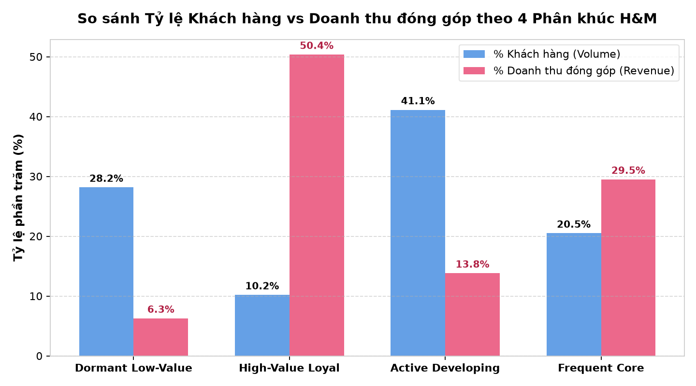
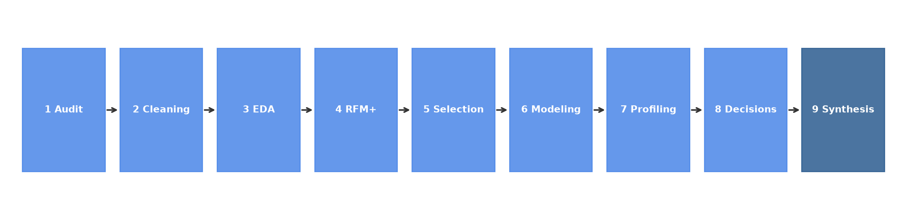
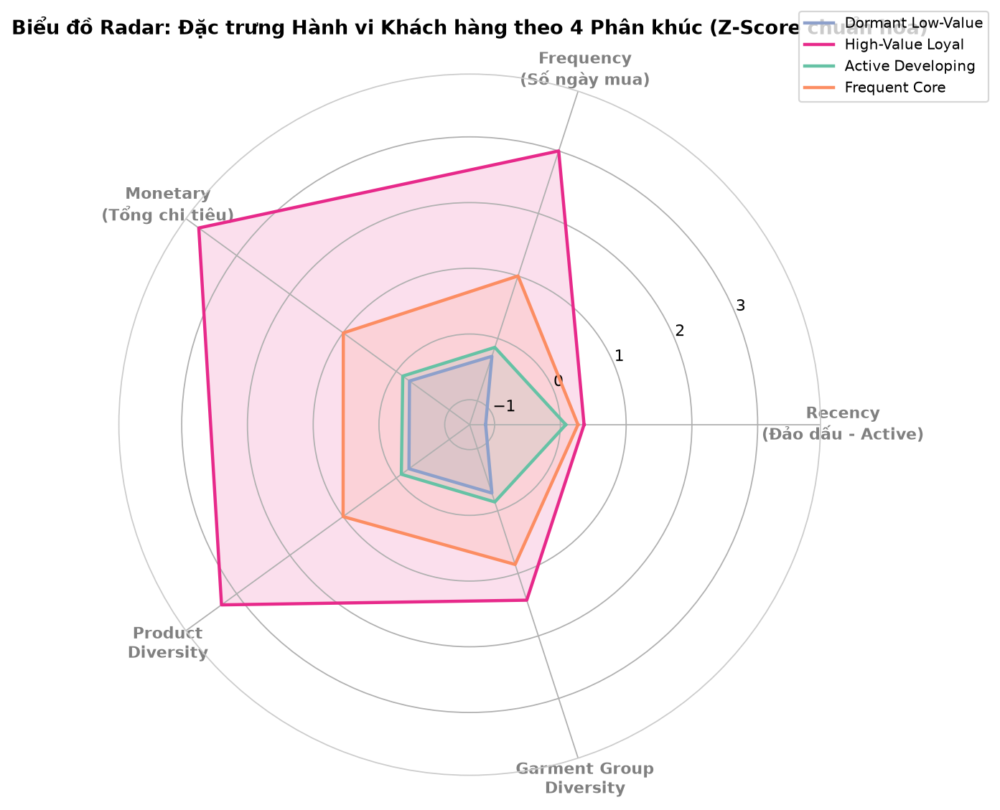
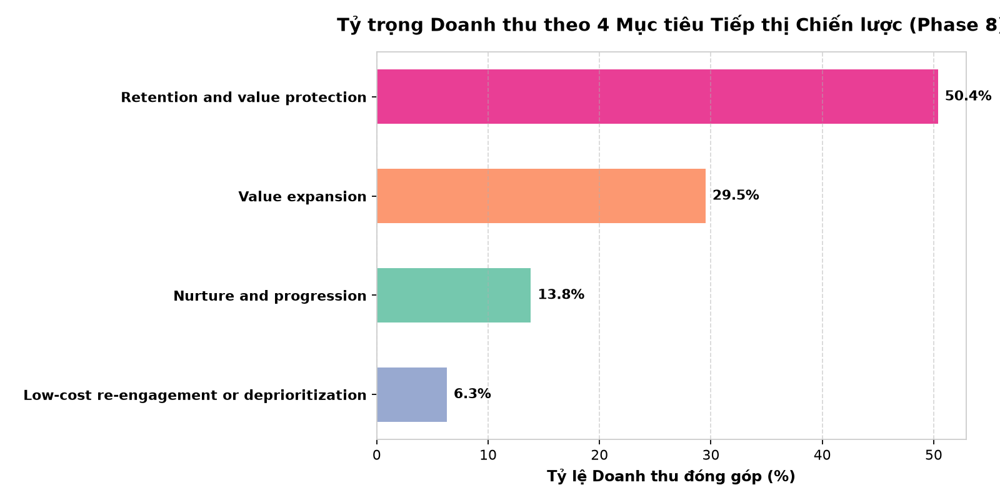

# Phân Khúc Khách Hàng H&M Bằng Học Máy Ứng Dụng Hỗ Trợ Quyết Định Marketing
## H&M Customer Segmentation & Marketing Intelligence System (CRISP-DM 9-Phase)

[](https://www.python.org/)
[]()
[-green.svg)]()
[](https://duckdb.org/)
[](https://www.kaggle.com/competitions/h-and-m-personalized-fashion-recommendations)

Đồ án môn học Khai phá Dữ liệu & Học máy Ứng dụng. Dự án xây dựng một hệ thống phân khúc khách hàng đa chiều hoàn chỉnh trên tập dữ liệu thời trang thực tế quy mô lớn của tập đoàn bán lẻ **H&M**, từ dữ liệu giao dịch thô đến mô hình hóa và tự động hóa hỗ trợ ra quyết định tiếp thị (Marketing Decision Support System).

---

## 📌 1. TỔNG QUAN DỰ ÁN & QUY MÔ DỮ LIỆU

* **Tập dữ liệu nguồn:** [H&M Personalized Fashion Recommendations (Kaggle)](https://www.kaggle.com/competitions/h-and-m-personalized-fashion-recommendations)
* **Quy mô xử lý:**
  - **31.788.324** lượt giao dịch mua sắm.
  - **1.362.281** khách hàng định danh có phát sinh giao dịch.
  - **105.542** mã sản phẩm thời trang.
  - Khung thời gian quan sát: 24 tháng (20/09/2018 – 22/09/2020).
* **Quy luật Pareto cốt lõi được phát hiện:**
  - 🏆 **Top 10.2% Khách hàng VIP (`High-Value Loyal`)** đóng góp tới **50.38%** tổng doanh thu toàn hệ thống.
  - 💪 **Top 30.7% Khách hàng thân thiết (`VIP + Core`)** đóng góp **79.89%** tổng doanh thu (gần như trùng khớp hoàn hảo với quy luật Pareto 80/20).
  - 😴 **69.3% Khách hàng còn lại (`Developing + Dormant`)** chỉ đóng góp **20.11%** doanh thu.



---

## 🏗️ 2. KIẾN TRÚC QUY TRÌNH PHƯƠNG PHÁP NGHIÊN CỨU (9 PHASES)

Dự án tuân thủ nghiêm ngặt tiêu chuẩn công nghiệp **CRISP-DM**, chia thành 9 giai đoạn logic và không bị rò rỉ dữ liệu (Temporal Data Leakage):



### Chi tiết 9 Giai đoạn:
1. **Phase 1 — Data Audit & Leakage Prevention:** Khóa mốc thời gian quan sát tại `SNAPSHOT_DATE = 2020-09-22`, ngăn ngừa rò rỉ dữ liệu tương lai.
2. **Phase 2 — Data Cleaning & Outlier Strategy:** Áp dụng biến đổi logarit $\ln(1+x)$ và phân vị Capping 99.9% trên dữ liệu lệch phải; khống chế RAM an toàn với DuckDB (`memory_limit = '2.5GB'`).
3. **Phase 3 — Exploratory Data Analysis (EDA):** Khám phá tính chu kỳ mùa vụ, phân phối giao dịch và xác thực mức độ tập trung doanh thu Pareto.
4. **Phase 4 — Feature Engineering (RFM + Extended):** Xây dựng Feature Store khách hàng 360 độ gồm 21 đặc trưng (RFM, nhịp mua, độ rộng tủ đồ, phân khúc giá).
5. **Phase 5 — Multi-Method Feature Selection:** Áp dụng cơ chế bầu chọn đồng thuận (Consensus) kết hợp ANOVA, Mutual Information và Random Forest, chắt lọc ra bộ 5 biến tối ưu: `recency_days`, `frequency_purchase_days`, `monetary_total_spend`, `product_diversity`, `product_type_diversity`.
6. **Phase 6 — Model Selection & Training:** Đánh giá đa thuật toán từ $k=2$ đến $k=8$; lựa chọn **K-Means $k=4$** dựa trên điểm uốn Elbow, đỉnh Calinski-Harabasz ($77.126,6$) và độ ổn định Bootstrap ($ARI = 0.865$).
7. **Phase 7 — Cluster Profiling & Validation:** Kiểm định phi tham số Kruskal-Wallis ($p < 10^{-15}$) và chuẩn hóa định danh 4 chân dung khách hàng độc lập.
8. **Phase 8 — Marketing Decision Support:** Xây dựng ma trận 4 chiến lược, 4 hành động, KPI và bộ rào chắn rủi ro (Guardrails); xuất file vận hành cho 1.362M khách hàng.
9. **Phase 9 — Synthesis & Final Evaluation:** Đối soát 17/17 artifacts, trả lời toàn diện 7 câu hỏi nghiên cứu RQ1–RQ7 và ghi nhận checklist tái lập.

---

## 👥 3. CHÂN DUNG 4 PHÂN KHÚC KHÁCH HÀNG H&M



| Cluster | Phân khúc | Khách hàng | % Khách | Doanh thu | % Doanh thu | Spend Index | Recency TB | Tần suất TB | Chi tiêu TB | Đặc trưng tủ đồ |
| :---: | :--- | :---: | :---: | :---: | :---: | :---: | :---: | :---: | :---: | :--- |
| **1** | 🏆 **High-Value Loyal** | 138.928 | **10.20%** | 445.659,9 | **50.38%** | **4.94** | **46,1 ngày** | **27,4 ngày** | **3,208** | Cực kỳ đa dạng ($14.2$ nhóm may mặc), mua sắm xuyên suốt các BST. |
| **3** | 💪 **Frequent Core** | 279.308 | 20.50% | 261.066,6 | **29.51%** | 1.44 | 92,0 ngày | 10,8 ngày | 0,935 | Đa dạng ($9.8$ nhóm), có thói quen mua lặp lại cố định. |
| **2** | 🌱 **Active Developing** | 560.287 | **41.13%** | 122.323,6 | 13.83% | 0.34 | 142,5 ngày | 2,9 ngày | 0,218 | Tủ đồ hẹp ($3.7$ nhóm), mới mua 1-2 đơn thăm dò. |
| **0** | 😴 **Dormant Low-Value** | 383.758 | 28.17% | 55.595,9 | 6.28% | 0.22 | 546,6 ngày | 1,6 ngày | 0.145 | Rất hẹp ($2.6$ nhóm), ngưng mua >1.5 năm, hàng giảm giá. |

*(Spend Index = % Doanh thu / % Khách hàng)*

---

## 🎯 4. MA TRẬN CHIẾN LƯỢC TIẾP THỊ & RÀO CHẮN NGHIỆP VỤ



| Phân khúc | Mục tiêu Tiếp thị | Hành động Trọng tâm | Định hướng Thông điệp | KPI Trọng tâm | Rào chắn Rủi ro (Guardrails) |
| :--- | :--- | :--- | :--- | :--- | :--- |
| 🏆 **High-Value Loyal** | **Bảo vệ giá trị & Giữ chân** | Đặc quyền VIP, quyền mua sớm (Early-access) BST giới hạn, CSKH ưu tiên. | *"Tri ân sự gắn kết đặc biệt — Khám phá sớm bộ sưu tập mới."* | Repeat purchase rate, Margin per customer | **Tuyệt đối không giảm giá xả kho** làm xói mòn biên lợi nhuận của 50.4% doanh thu. |
| 💪 **Frequent Core** | **Mở rộng giá trị giỏ hàng** | Bán chéo combo phụ kiện phối đồ, ưu đãi giá trị giỏ hàng bậc thang. | *"Hoàn thiện phong cách thường nhật với các phụ kiện phối chuẩn."* | Spend per purchase day, Category breadth | Không thúc ép hàng cao cấp nếu khách có xu hướng chuộng mức giá vừa phải. |
| 🌱 **Active Developing** | **Nuôi dưỡng & Kích hoạt đơn thứ 2** | Gợi ý Best-sellers theo độ tuổi, chuỗi email chào mừng, ưu đãi đơn thứ 2 trong 30 ngày. | *"Bạn đã thích món đồ đầu tiên? Khám phá ngay các mẫu phối ăn ý nhất."* | 2nd purchase conversion rate, Days to next purchase | Khách dễ rời bỏ nếu thiếu sự chăm sóc sau đơn hàng đầu tiên. |
| 😴 **Dormant Low-Value** | **Tái kích hoạt chi phí thấp** | Email tin tức tự động định kỳ, khảo sát ngắn tìm hiểu lý do rời bỏ. | *"H&M đã có nhiều diện mạo mới — Nhận khảo sát 1 phút để nhận quà."* | Email open rate, Reactivation rate | **Không chạy quảng cáo trả phí (Paid Ads)** khi tỷ lệ phản hồi dự kiến thấp. |

---

## 🚀 5. HƯỚNG DẪN CÀI ĐẶT & CHẠY ỨNG DỤNG

### 5.1 Cài đặt môi trường
Khuyến nghị sử dụng Python 3.10 trở lên:
```bash
git clone https://github.com/TminTtapcode/BTL_PTDL.git
cd BTL_PTDL
pip install -r requirements.txt
```

### 5.2 Khởi động Web Dashboard Tương tác (Zero-Config)
Dự án tích hợp sẵn Web App hiện đại (Tailwind CSS + Chart.js + DuckDB API):
```bash
python web_app.py
```
👉 Mở trình duyệt truy cập: **`http://localhost:8050`**
* **Tính năng:**
  - *Tab 1:* Tổng quan điều hành & Biểu đồ tương tác Donut Pareto, Radar hành vi.
  - *Tab 2:* Chi tiết 4 phân khúc khách hàng & ma trận tiếp thị.
  - *Tab 3:* **Tra cứu khách hàng thật:** Tìm kiếm tức thì trong 1.362M khách hàng bằng DuckDB.
  - *Tab 4:* **Mô phỏng What-If:** Nhập thông số R-F-M để mô hình K-Means suy luận trực tiếp.

### 5.3 Chạy toàn bộ quy trình kiểm chứng dữ liệu thực tế
```bash
python run_full_pipeline.py
```

---

## 📂 6. CẤU TRÚC THƯ MỤC DỰ ÁN

```text
BTL_PTDL/
├── docs/                                   # Báo cáo học thuật chi tiết
│   ├── BaoCao_KhoaHoc_5Trang.md            # Báo cáo chuẩn 5 trang A4
│   ├── BaoCao_TrichYeu_ThuyetTrinh.md      # Tóm tắt thuyết trình & Slide brief
│   └── BaoCao_ToanDien_9Phase.md           # Thuyết minh toàn diện 9 Phase
├── notebooks/                              # 9 Jupyter Notebooks chuẩn CRISP-DM
│   ├── Customer_Segmentation_HM_Phase1_Audit.ipynb
│   ├── Customer_Segmentation_HM_Phase2_Cleaning.ipynb
│   ├── Customer_Segmentation_HM_Phase3_EDA.ipynb
│   ├── Customer_Segmentation_HM_Phase4_RFM_Extended_Features.ipynb
│   ├── Customer_Segmentation_HM_Phase5_Feature_Selection.ipynb
│   ├── Customer_Segmentation_HM_Phase6_Model_Selection.ipynb
│   ├── Customer_Segmentation_HM_Phase7_Cluster_Profiling.ipynb
│   ├── Customer_Segmentation_HM_Phase8_Marketing_Decision_Support.ipynb
│   └── Customer_Segmentation_HM_Phase9_Final_Evaluation.ipynb
├── data/
│   ├── models/                             # File model và preprocessor đã huấn luyện
│   │   ├── final_cluster_model.joblib
│   │   └── final_preprocessor.joblib
│   ├── features/                           # Danh sách đặc trưng ứng viên
│   └── results/                            # Kết quả chiến lược và sở thích phân khúc
├── reports/
│   ├── figures/                            # Toàn bộ biểu đồ phân tích 9 phase
│   ├── tables/                             # Các bảng số liệu trung gian
│   └── final/                              # Bộ tài sản nghiệm thu đồ án (17 artifacts)
├── web_app.py                              # Web Dashboard trực quan (Port 8050)
├── run_full_pipeline.py                    # Script chạy kiểm tra dữ liệu thật
├── requirements.txt                        # Danh mục thư viện phụ thuộc
├── .gitignore                              # Cấu hình bỏ qua Big Data (>100MB)
└── README.md                               # Tài liệu hướng dẫn chính
```

---

## 📄 7. TÀI LIỆU BÁO CÁO CHI TIẾT
* [Báo cáo chuẩn khoa học 5 trang](docs/BaoCao_KhoaHoc_5Trang.md)
* [Bản trích yếu báo cáo & Kịch bản thuyết trình](docs/BaoCao_TrichYeu_ThuyetTrinh.md)
* [Báo cáo toàn diện quy trình 9 Phase](docs/BaoCao_ToanDien_9Phase.md)

---
*Đồ án môn học Khai phá Dữ liệu — HK1/2026.*
