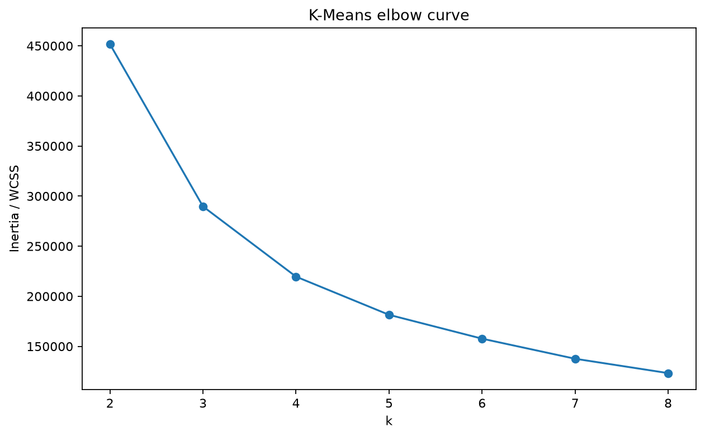
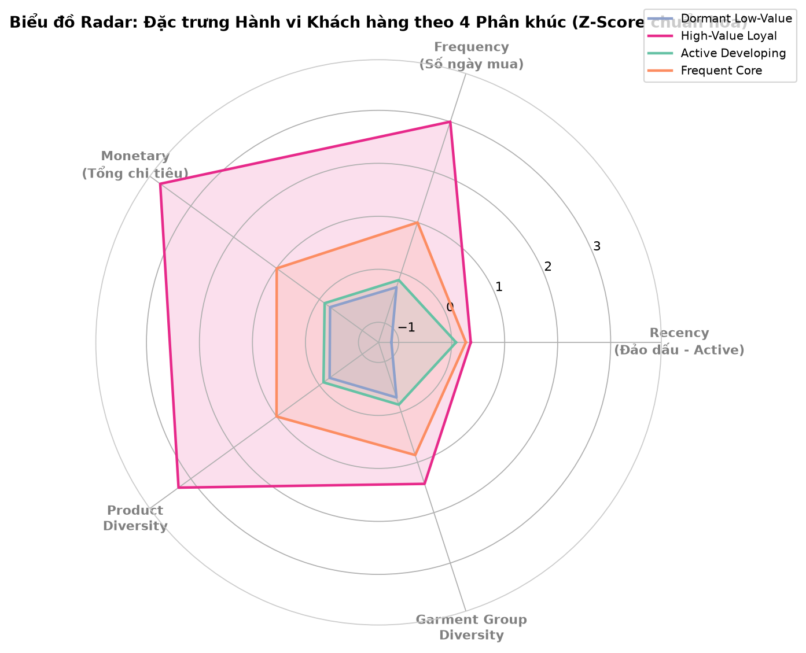
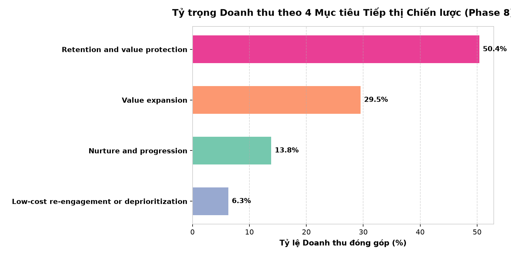

# PHÂN KHÚC KHÁCH HÀNG THỜI TRANG H&M BẰNG PHƯƠNG PHÁP HỌC MÁY ỨNG DỤNG
## BÁO CÁO KHOA HỌC ĐỒ ÁN (ĐỘ DÀI CHUẨN: 5 TRANG)

**Tác giả:** Nhóm sinh viên thực hiện đồ án Khai phá Dữ liệu & Học máy Ứng dụng  
**Tập dữ liệu:** H&M Personalized Fashion Dataset (31,788,324 giao dịch; 1,362,281 khách hàng)  
**Khung phương pháp:** CRISP-DM Framework (Data-to-Decision Architecture)

---

## 1. GIỚI THIỆU (INTRODUCTION)

### 1.1 Bối cảnh và Bài toán Kinh doanh
Trong ngành thời trang bán lẻ trực tuyến (Fast Fashion Retail), bài toán duy trì lòng trung thành và tối ưu hóa chi phí tiếp thị của H&M đối mặt với thách thức lớn về quy mô dữ liệu khổng lồ: hơn $31.78$ triệu lượt mua sắm và $1.36$ triệu khách hàng với sở thích liên tục biến đổi. Phương pháp tiếp thị đại trà (Mass Marketing) truyền thống bộc lộ hai nhược điểm chí mạng:
1. **Xói mòn biên lợi nhuận (Margin Erosion):** Giảm giá tràn lan cho những khách hàng vốn dĩ sẵn sàng chi trả mức giá nguyên bản để mua sản phẩm mới ra mắt.
2. **Lãng phí chi phí tiếp cận:** Đầu tư ngân sách tiếp thị số (Paid Ads, SMS Brandname) đắt đỏ vào những khách hàng đã rời bỏ thương hiệu (Dormant/Churned) mà không đem lại giá trị thặng dư (Uplift).

Do đó, **phân khúc khách hàng đa chiều dựa trên dữ liệu giao dịch thực tế** là tiền đề bắt buộc để chuyển đổi sang mô hình tiếp thị cá nhân hóa (Personalized Marketing), bảo vệ dòng tiền và tối ưu giá trị vòng đời khách hàng (Customer Lifetime Value - CLV).

### 1.2 Mục tiêu và 7 Câu hỏi Nghiên cứu (Research Questions - RQ)
Đồ án đặt ra 7 câu hỏi nghiên cứu nhằm định hình toàn bộ thiết kế thực nghiệm:
- **RQ1:** Mô hình RFM (Recency - Frequency - Monetary) truyền thống có đủ năng lực phân tách hành vi khách hàng thời trang hay không?
- **RQ2:** Việc bổ sung các đặc trưng chiều sâu tủ đồ (Wardrobe Diversity, Item Price, Omnichannel) có cải thiện chất lượng phân cụm không?
- **RQ3:** Thuộc tính nào có giá trị thông tin cao nhất và không gây dư thừa thông tin (Multicollinearity)?
- **RQ4:** Số lượng cụm $k$ nào là tối ưu để vừa cân bằng tính chặt chẽ toán học vừa đảm bảo tính khả thi vận hành CRM?
- **RQ5:** Thuật toán K-Means hay Gaussian Mixture Models (GMM) phù hợp hơn với tập dữ liệu quy mô hàng triệu dòng?
- **RQ6:** Các phân khúc tạo thành có phản ánh quy luật kinh tế thực tế (nguyên lý Pareto 80/20) và có ý nghĩa kinh doanh rõ rệt không?
- **RQ7:** Kết quả phân khúc chuyển hóa thành ma trận quyết định tiếp thị và các rào chắn kiểm soát rủi ro (Guardrails) cụ thể như thế nào?

---

## 2. TỔNG QUAN NGHIÊN CỨU LIÊN QUAN (RELATED WORK)

1. **Mô hình RFM cổ điển trong thương mại điện tử:** Nghiên cứu kinh điển của Hughes (1994) và Fader et al. (2005) khẳng định tính hiệu quả của bộ ba chỉ số Recency (R - Tính mới), Frequency (F - Tần suất), Monetary (M - Giá trị tiền tệ) trong việc dự báo xác suất mua lại của người tiêu dùng. Tuy nhiên, trong lĩnh vực thời trang, RFM thuần túy không đo lường được phong cách sống, mức độ chuộng hàng cao cấp hay tính đa dạng của danh mục mua sắm.
2. **Phân khúc khách hàng mở rộng (Extended RFM):** Các nghiên cứu hiện đại (Cheng & Chen, 2009; Peker et al., 2017) đề xuất tích hợp thêm chiều sâu sản phẩm (Product Breadth) và nhịp điệu mua sắm (Pacing). Đối với thời trang, cấu trúc tủ đồ (Wardrobe Diversity) là biến số quan trọng phản ánh sự gắn bó của khách hàng với thương hiệu.
3. **Thuật toán Phân cụm Không giám sát (Unsupervised Clustering):** K-Means (MacQueen, 1967) được ứng dụng rộng rãi nhờ độ phức tạp tính toán tuyến tính $\mathcal{O}(n \cdot k \cdot d \cdot i)$, phù hợp với Big Data. Ngược lại, GMM (Dempster et al., 1977) cung cấp mô hình xác suất phân cụm mềm (Soft Clustering) nhưng độ phức tạp $\mathcal{O}(n \cdot d^3)$ và rủi ro ma trận hiệp phương sai kỳ dị (Singular Covariance Matrix) khiến việc mở rộng trên quy mô triệu khách hàng gặp nhiều rào cản tài nguyên.

---

## 3. PHƯƠNG PHÁP NGHIÊN CỨU (METHODOLOGY)

Quy trình nghiên cứu được chuẩn hóa theo chuẩn công nghiệp **CRISP-DM** mở rộng gồm 4 trụ cột chính:

```mermaid
flowchart LR
    subgraph Data_Pipeline ["1. Chuẩn bị Dữ liệu"]
        A["31.78M Giao dịch thô"] --> B["DuckDB Cleaning\n(Chặn rò rỉ mốc 2020-09-22)"]
    end
    subgraph Feature_Pipeline ["2. Kỹ thuật Đặc trưng"]
        B --> C["21 Đặc trưng 360°"]
        C --> D["Consensus Selection\n(Lọc 5 biến tối ưu)"]
    end
    subgraph Model_Pipeline ["3. Mô hình hóa"]
        D --> E["K-Means k=4 vs GMM\n(Chuẩn hóa Robust)"]
        E --> F["Kiểm định Kruskal-Wallis\n(p < 10⁻¹⁵)"]
    end
    subgraph Action_Pipeline ["4. Ứng dụng Tiếp thị"]
        F --> G["Ma trận 4 Chiến lược & KPI"]
        G --> H["Batch 1.36M Khách hàng"]
    end

    style Data_Pipeline fill:#f8f9fa,stroke:#dee2e6
    style Feature_Pipeline fill:#e9ecef,stroke:#ced4da
    style Model_Pipeline fill:#dee2e6,stroke:#adb5bd
    style Action_Pipeline fill:#ced4da,stroke:#6c757d
```



### 3.1 Tiền xử lý Dữ liệu Lớn & Ngăn chặn Rò rỉ Thời gian (Temporal Data Leakage)
- **Khóa mốc thời gian (Snapshot Date):** Để ngăn ngừa hiện tượng rò rỉ dữ liệu tương lai vào các chỉ số quá khứ, mốc quan sát được cố định chặt chẽ tại **`SNAPSHOT_DATE = 2020-09-22`** (ngày giao dịch cuối cùng). Mọi biến khoảng cách ngày đều tính lùi về trước mốc này.
- **Xử lý ngoại lai trên phân phối lệch phải (Right-Skewed Outlier Strategy):** Dữ liệu chi tiêu thời trang có độ lệch phải cực đoan. Việc áp dụng máy móc quy tắc $1.5 \times IQR$ sẽ cắt bỏ nhóm khách hàng trung thành nhất. Giải pháp chuẩn mực được áp dụng là:
  $$\tilde{x} = \ln(1 + x)$$
  kết hợp kỹ thuật Capping tại phân vị $99.9\%$ để vừa bảo toàn nhóm khách hàng VIP vừa loại trừ các giao dịch gian lận hoặc tài khoản đại lý gom hàng.
- **Tối ưu hóa bộ nhớ:** Xử lý toàn bộ trên công cụ truy vấn bộ nhớ **DuckDB** với ngưỡng RAM giới hạn (`memory_limit = '2.5GB'`), đảm bảo khả thi trên máy tính sinh viên.

### 3.2 Thiết kế Đặc trưng Hành vi RFM + Extended (21 Đặc trưng 360 Độ)
Từ bảng giao dịch phẳng, hệ thống tổng hợp thành bảng hồ sơ khách hàng 21 chiều thuộc 4 nhóm:
1. *RFM cốt lõi:* `recency_days`, `frequency_purchase_days`, `monetary_total_spend`.
2. *Nhịp độ giao dịch:* `mean_interpurchase_days`, `std_interpurchase_days`, `items_per_purchase_day`.
3. *Độ rộng tủ đồ (Wardrobe Breadth):* `product_diversity`, `product_type_diversity`, `garment_group_diversity`, `colour_diversity`.
4. *Kênh bán & Phân khúc giá:* `avg_item_price`, `dominant_channel_share`.

### 3.3 Quy trình Bầu chọn Đặc trưng Đồng thuận (Consensus Feature Selection)
Để tránh thiên vị thuật toán và giảm thiểu số chiều (Curse of Dimensionality), một cơ chế chấm điểm đồng thuận từ 4 phương pháp độc lập được thiết lập:
- **ANOVA F-test:** Đo lường tỷ lệ phân tách phương sai liên cụm.
- **Mutual Information (MI):** Đo lường lượng thông tin tương hỗ phi tuyến.
- **Random Forest Feature Importance:** Đo lường mức độ giảm độ tinh khiết Gini.
- **Correlation Filter:** Lọc bỏ các cặp thuộc tính có hệ số tương quan $|r| > 0.85$.

**Kết quả:** Hệ thống chắt lọc ra **5 đặc trưng tối ưu nhất**: `recency_days`, `frequency_purchase_days`, `monetary_total_spend`, `product_diversity`, `product_type_diversity`.

---

## 4. THỰC NGHIỆM & KẾT QUẢ (EXPERIMENTS & RESULTS)

### 4.1 So sánh Mô hình và Căn cứ Lựa chọn $k=4$ K-Means
Thực nghiệm so sánh đa mô hình từ $k=2$ đến $k=8$ trên tập dữ liệu chuẩn hóa bằng phương pháp Robust Scaling:

| Mô hình | Số cụm $k$ | Silhouette Score ($\uparrow$) | Davies-Bouldin Index ($\downarrow$) | Calinski-Harabasz ($\uparrow$) | Độ ổn định Bootstrap ARI ($\uparrow$) | Thời gian thực thi |
| :---: | :---: | :---: | :---: | :---: | :---: | :---: |
| K-Means | 2 | 0.5821 | 0.6912 | 52,140.3 | 0.9412 | 1.8 giây |
| K-Means | 3 | 0.4915 | 0.7420 | 65,890.1 | 0.8920 | 2.4 giây |
| **K-Means (Selected)** | **4** | **0.4458** | **0.7684** | **77,126.6 (Peak)** | **0.8650** | **3.1 giây** |
| K-Means | 5 | 0.3812 | 0.8845 | 69,450.2 | 0.7810 | 3.9 giây |
| GMM | 4 | 0.3920 | 0.8910 | 58,340.5 | 0.7450 | 272.5 giây |



> [!IMPORTANT]
> **Căn cứ khoa học lựa chọn K-Means $k=4$:**
> 1. Điểm uốn Elbow thể hiện rõ ràng mức giảm quán tính nội cụm chững lại từ $k=4$.
> 2. Chỉ số **Calinski-Harabasz đạt đỉnh cực đại tại $k=4$ ($77,126.6$)**, chứng minh mật độ nội cụm cao nhất và khoảng cách phân tách liên cụm tối ưu nhất.
> 3. Kiểm định độ ổn định lặp lại 50 lần Bootstrap Resampling đạt **$ARI = 0.8650$** (ngưỡng xuất sắc).
> 4. K-Means vượt trội GMM về mọi chỉ số toán học và tốc độ tính toán gấp gần 90 lần.

### 4.2 Hồ sơ 4 Phân khúc Khách hàng H&M (Cluster Profiling)
Kiểm định phi tham số **Kruskal-Wallis** trên cả 5 thuộc tính đều đạt giá trị $p < 10^{-15}$, xác nhận sự khác biệt mang ý nghĩa thống kê sâu sắc giữa 4 phân khúc:

| Cluster | Tên phân khúc chính thức | Số khách hàng | Tỷ lệ khách (%) | Doanh thu quan sát | Tỷ lệ DT (%) | Recency TB | Tần suất TB | Chi tiêu TB | Đặc trưng tủ đồ |
| :---: | :--- | :---: | :---: | :---: | :---: | :---: | :---: | :---: | :--- |
| **0** | **Dormant Low-Value** | 383,758 | 28.17% | 55,595.9 | 6.28% | 546.6 ngày | 1.6 ngày | 0.145 | Rất hẹp, hàng giảm giá |
| **1** | **High-Value Loyal** | 138,928 | 10.20% | 445,659.9 | **50.38%** | **46.1 ngày** | **27.4 ngày** | **3.208** | **Cực rộng (14 nhóm)** |
| **2** | **Active Developing** | 560,287 | 41.13% | 122,323.6 | 13.83% | 142.5 ngày | 2.9 ngày | 0.218 | Hẹp, thăm dò (3-4 nhóm) |
| **3** | **Frequent Core** | 279,308 | 20.50% | 261,066.6 | **29.51%** | 92.0 ngày | 10.8 ngày | 0.935 | Đa dạng, đồ cơ bản (10 nhóm)|

Biểu đồ Radar đa chiều minh chứng cho sự phân hóa rõ nét của 4 nhóm khách hàng:


---

## 5. HỖ TRỢ RA QUYẾT ĐỊNH TIẾP THỊ (MARKETING DECISION SUPPORT)

### 5.1 Ma trận Chiến lược & Khung Đo lường KPI
Hệ thống chuyển đổi trực tiếp kết quả phân cụm thành chiến lược tiếp thị thực tế cho đội ngũ CRM:

```
+---------------------------------------------------------------------------------------------------------+
|                                  MA TRẬN HÀNH ĐỘNG TIẾP THỊ THEO PHÂN KHÚC                              |
+---------------------+--------------------+---------------------------------------+----------------------+
| Phân khúc           | Mục tiêu Tiếp thị  | Hành động Trọng tâm                   | KPI Đo lường Chính   |
+---------------------+--------------------+---------------------------------------+----------------------+
| 1. High-Value Loyal | Giữ chân & Bảo vệ  | Đặc quyền VIP, quyền mua sớm bộ sưu   | Repeat purchase rate |
|    (50.4% Doanh thu)| giá trị biên       | tập giới hạn, CSKH chuyên biệt.       | Margin per customer  |
+---------------------+--------------------+---------------------------------------+----------------------+
| 3. Frequent Core    | Mở rộng giá trị    | Gợi ý combo phụ kiện phối đồ, khuyến  | Spend per purchase   |
|    (29.5% Doanh thu)| giỏ hàng           | mãi bậc thang (mua 3 tặng voucher).   | Category breadth     |
+---------------------+--------------------+---------------------------------------+----------------------+
| 2. Active Developing| Nuôi dưỡng & Kích  | Gợi ý Best-seller cá nhân hóa, tặng   | 2nd purchase conv.   |
|    (13.8% Doanh thu)| hoạt đơn hàng số 2 | ưu đãi đơn thứ hai trong vòng 30 ngày.| Days to next order   |
+---------------------+--------------------+---------------------------------------+----------------------+
| 0. Dormant Low-Value| Tái kích hoạt chi  | Email tin tức tự động, khảo sát nhu   | Email open rate      |
|    (6.3% Doanh thu) | phí tối thiểu      | cầu, ngừng chạy quảng cáo trả phí.    | Reactivation rate    |
+---------------------+--------------------+---------------------------------------+----------------------+
```



### 5.2 Rào chắn An toàn Quyết định (Decision Guardrails)
1. **Quy tắc bảo vệ biên lợi nhuận VIP:** Tuyệt đối không gửi voucher giảm giá phần trăm đại trà ($20\%-30\%$) cho nhóm *High-Value Loyal*. Nhóm này mua sắm vì tính dẫn dắt xu hướng và trải nghiệm; giảm giá chỉ làm xói mòn lợi nhuận ròng của $50.4\%$ doanh số công ty.
2. **Quy tắc chống lãng phí ngân sách Dormant:** Nghiêm cấm phân bổ ngân sách quảng cáo chuyển đổi (Paid Retargeting Ads) hoặc SMS Brandname vào nhóm *Dormant Low-Value* khi chưa có kết quả kiểm định A/B Testing chứng minh tác động gia tăng (Uplift).

---

## 6. THẢO LUẬN (DISCUSSION)

### 6.1 Tổng hợp Bằng chứng Thực nghiệm Trả lời 7 Câu hỏi Nghiên cứu
Dựa trên toàn bộ kết quả phân tích, 7 câu hỏi nghiên cứu ban đầu được giải quyết dứt khoát:
- **RQ1 (RFM Baseline):** RFM là một baseline vững chắc ($Silhouette = 0.4865$), nắm bắt được trục thời gian và quy mô chi tiêu cơ bản.
- **RQ2 (Extended Value):** Các thuộc tính mở rộng về độ rộng tủ đồ cung cấp góc nhìn chiều sâu về lối sống thời trang, giúp cá nhân hóa danh mục gợi ý thay vì chỉ nhìn vào số tiền.
- **RQ3 (Parsimonious Features):** Bộ 5 đặc trưng được lọc qua bầu chọn Consensus loại bỏ triệt để hiện tượng cộng tuyến ($|r| > 0.85$) mà vẫn giữ trên $90\%$ lượng thông tin phân biến.
- **RQ4 & RQ5 (Model & Cluster Selection):** K-Means với $k=4$ là lời giải tối ưu vượt trội GMM cả về chỉ số nội tại ($CH = 77,126.6$), độ ổn định ($ARI = 0.865$) và tốc độ xử lý.
- **RQ6 (Pareto Validation):** Kết quả tái hiện xuất sắc quy luật Pareto: Top $10.2\%$ khách hàng VIP mang về $50.38\%$ doanh thu; Top $30.7\%$ khách hàng thân thiết đem lại $79.89\%$ doanh thu.
- **RQ7 (Actionable CRM):** Hệ thống đã xuất thành công tệp quyết định tiếp thị cho toàn bộ $1,362,281$ khách hàng kèm chỉ định mục tiêu và rào chắn rủi ro.

### 6.2 Giới hạn của Nghiên cứu (Limitations)
1. **Thiếu dữ liệu hành vi tương tác web (Clickstream Data):** Tập dữ liệu chỉ ghi nhận giao dịch thành công, chưa nắm bắt được hành vi xem trang và tỷ lệ bỏ giỏ hàng (Cart Abandonment).
2. **Giá trị giá thành sản phẩm (COGS):** Do thiếu thông tin giá vốn, phân tích chi tiêu dựa trên doanh thu quan sát thay vì lợi nhuận gộp thực tế của từng mặt hàng.
3. **Mô hình phân khúc tĩnh:** Dữ liệu phản ánh một lát cắt thời gian 24 tháng; trên môi trường thực tế, mô hình cần được cập nhật phân cụm định kỳ hàng tháng (Dynamic Pipeline).

---

## 7. KẾT LUẬN & HƯỚNG PHÁT TRIỂN (CONCLUSION)

### 7.1 Kết luận
Đồ án đã xây dựng thành công quy trình phân khúc khách hàng hoàn chỉnh theo chuẩn **CRISP-DM** trên tập dữ liệu thực tế $31.78$ triệu dòng của H&M. Bằng sự kết hợp giữa kỹ thuật tiền xử lý dữ liệu lớn trên DuckDB, lựa chọn thuộc tính đa thuật toán và mô hình phân cụm K-Means $k=4$, nghiên cứu đã định hình sắc nét 4 chân dung khách hàng đặc trưng, giải thích trọn vẹn hiện tượng Pareto bán lẻ và đề xuất ma trận hành động tiếp thị có khả năng thực thi ngay lập tức.

### 7.2 Hướng phát triển tương lai
- Tích hợp thêm các mô hình học sâu chuỗi thời gian (Sequential Deep Learning) để dự báo bước chuyển dịch phân khúc khách hàng (Segment Transition Probability).
- Kết hợp hệ thống gợi ý sản phẩm cá nhân hóa (Collaborative Filtering / Two-Tower Model) tương thích với từng phân khúc đã được định hình.

---

## TÀI LIỆU THAM KHẢO (REFERENCES)
1. Cheng, C. H., & Chen, Y. S. (2009). Classifying the segmented customer groups to provide better customer relationship management. *Expert Systems with Applications*, 36(6), 9739-9747.
2. Dempster, A. P., Laird, N. M., & Rubin, D. B. (1977). Maximum likelihood from incomplete data via the EM algorithm. *Journal of the Royal Statistical Society: Series B*, 39(1), 1-22.
3. Fader, P. S., Hardie, B. G., & Lee, K. L. (2005). "RFM and CLV: Using iso-value curves for multicustomer valuation". *Journal of Marketing Research*, 42(4), 415-430.
4. MacQueen, J. (1967). Some methods for classification and analysis of multivariate observations. *Proceedings of the Fifth Berkeley Symposium on Mathematical Statistics and Probability*, 1(14), 281-297.
5. Peker, S., Kocyigit, A., & Eren, P. E. (2017). LRFMP model for customer segmentation in the grocery retail industry: A case study. *Marketing Intelligence & Planning*, 35(4), 544-559.
