# BÁO CÁO TOÀN DIỆN QUY TRÌNH PHÂN KHÚC KHÁCH HÀNG THỜI TRANG H&M
## ĐỒ ÁN MÔN HỌC: KHAI PHÁ DỮ LIỆU & HỌC MÁY ỨNG DỤNG (CRISP-DM 9-PHASE FRAMEWORK)

---

> [!NOTE]
> **Tổng quan Đồ án:**
> - **Tập dữ liệu:** H&M Personalized Fashion Recommendations (Kaggle).
> - **Quy mô dữ liệu xử lý:** **31,788,324** giao dịch, **1,362,281** khách hàng định danh, **105,542** mã sản phẩm thời trang.
> - **Thời gian giao dịch:** 24 tháng (từ tháng 09/2018 đến tháng 09/2020).
> - **Khung phương pháp:** Tiêu chuẩn công nghiệp **CRISP-DM** (Cross-Industry Standard Process for Data Mining) mở rộng thành 9 giai đoạn logic, đảm bảo tính chặt chẽ từ toán học đến triển khai chiến lược kinh doanh.

---

## MỤC LỤC
1. [CHƯƠNG 1: BỐI CẢNH BÀI TOÁN KINH DOANH & CÂU HỎI NGHIÊN CỨU](#chương-1-bối-cảnh-bài-toán-kinh-doanh--câu-hỏi-nghiên-cứu)
2. [CHƯƠNG 2: KIẾN TRÚC TỔNG THỂ HỆ THỐNG PHÂN TÍCH (PIPELINE)](#chương-2-kiến-trúc-tổng-thể-hệ-thống-phân-tích-pipeline)
3. [CHƯƠNG 3: CHI TIẾT 9 GIAI ĐOẠN THỰC THI (PHASE 1 - PHASE 9)](#chương-3-chi-tiết-9-giai-đoạn-thực-thi-phase-1---phase-9)
   - [Phase 1: Kiểm định Dữ liệu & Ngăn ngừa Rò rỉ (Audit & Leakage Prevention)](#phase-1-kiểm-định-dữ-liệu--ngăn-ngừa-rò-rỉ-audit--leakage-prevention)
   - [Phase 2: Tiền xử lý & Làm sạch Dữ liệu Lớn (Data Cleaning)](#phase-2-tiền-xử-lý--làm-sạch-dữ-liệu-lớn-data-cleaning)
   - [Phase 3: Khám phá Dữ liệu Chuyên sâu (Exploratory Data Analysis)](#phase-3-khám-phá-dữ-liệu-chuyên-sâu-exploratory-data-analysis)
   - [Phase 4: Thiết kế Đặc trưng Hành vi RFM + Extended (Feature Engineering)](#phase-4-thiết-kế-đặc-trưng-hành-vi-rfm--extended-feature-engineering)
   - [Phase 5: Lựa chọn Đặc trưng Đa tầng (Feature Selection)](#phase-5-lựa-chọn-đặc-trưng-đa-tầng-feature-selection)
   - [Phase 6: So sánh & Huấn luyện Mô hình Phân cụm (Model Selection)](#phase-6-so-sánh--huấn-luyện-mô-hình-phân-cụm-model-selection)
   - [Phase 7: Hồ sơ Hóa Phân khúc & Kiểm định Ý nghĩa Thống kê (Cluster Profiling)](#phase-7-hồ-sơ-hóa-phân-khúc--kiểm-định-ý-nghĩa-thống-kê-cluster-profiling)
   - [Phase 8: Hệ thống Hỗ trợ Quyết định Marketing (Marketing Decision Support)](#phase-8-hệ-thống-hỗ-trợ-quyết-định-marketing-marketing-decision-support)
   - [Phase 9: Đánh giá Tổng kết, Trả lời 7 Câu hỏi Nghiên cứu & Giới hạn](#phase-9-đánh-giá-tổng-kết-trả-lời-7-câu-hỏi-nghiên-cứu--giới-hạn)
4. [CHƯƠNG 4: DANH MỤC TÀI LIỆU, MÃ NGUỒN VÀ DỮ LIỆU ĐỒ ÁN](#chương-4-danh-mục-tài-liệu-mã-nguồn-và-dữ-liệu-đồ-án)

---

## CHƯƠNG 1: BỐI CẢNH BÀI TOÁN KINH DOANH & CÂU HỎI NGHIÊN CỨU

### 1.1 Bối cảnh Thực tế tại H&M
H&M (Hennes & Mauritz) là một trong những tập đoàn bán lẻ thời trang nhanh (Fast Fashion) lớn nhất toàn cầu. Với danh mục sản phẩm thay đổi theo tuần và hàng chục triệu khách hàng trực tuyến lẫn cửa hàng thực tế, việc áp dụng cùng một chiến dịch tiếp thị đại trà (Mass Marketing) gây ra hai hệ lụy nghiêm trọng:
1. **Lãng phí chi phí tiếp thị (Marketing Waste):** Giảm giá tràn lan cho nhóm khách hàng vốn dĩ sẵn sàng chi trả mức giá nguyên bản (Margin Erosion).
2. **Gia tăng tỷ lệ rời bỏ (Customer Churn):** Khách hàng tiềm năng bị làm phiền bởi những gợi ý sản phẩm không đúng độ tuổi hoặc phong cách thời trang, trong khi khách hàng ngủ đông không nhận được động lực kích hoạt lại phù hợp.

Do đó, **Phân khúc khách hàng (Customer Segmentation)** là bước đi chiến lược mang tính sống còn để chuyển đổi từ tiếp thị cảm tính sang tiếp thị dữ liệu hóa cá nhân hóa (Data-Driven Personalized Marketing).

### 1.2 Câu hỏi Nghiên cứu Trọng tâm (Research Questions)
Đồ án được thiết kế để giải quyết tuần tự và có căn cứ 7 câu hỏi nghiên cứu cốt lõi:
- **RQ1 (Baseline Validity):** *Mô hình RFM (Recency - Frequency - Monetary) truyền thống có đủ năng lực phân tách hành vi khách hàng thời trang hay không?*
- **RQ2 (Extended Feature Value):** *Việc bổ sung các đặc trưng chiều sâu thời trang (Wardrobe Diversity, Item Price, Omnichannel) có cải thiện chất lượng phân cụm không?*
- **RQ3 (Feature Parsimony):** *Những thuộc tính nào là quan trọng nhất và không gây dư thừa thông tin (redundancy) đối với thuật toán?*
- **RQ4 (Optimal Cohort Size):** *Số lượng cụm $k$ nào là tối ưu để vừa đảm bảo tính cô đọng toán học vừa phù hợp với nguồn lực vận hành của phòng Marketing?*
- **RQ5 (Algorithm Choice):** *Thuật toán K-Means truyền thống hay Gaussian Mixture Models (GMM) phù hợp hơn với dữ liệu quy mô hàng triệu khách hàng?*
- **RQ6 (Business Interpretability):** *Các cụm tạo thành có tách biệt rõ rệt về mặt hành vi kinh doanh và có ý nghĩa kinh tế (Pareto) hay không?*
- **RQ7 (Actionable Decision Support):** *Phân khúc này hỗ trợ cụ thể như thế nào cho các chiến dịch Marketing và KPI thực tế của doanh nghiệp?*

---

## CHƯƠNG 2: KIẾN TRÚC TỔNG THỂ HỆ THỐNG PHÂN TÍCH (PIPELINE)

Đồ án tuân thủ nghiêm ngặt quy trình khoa học dữ liệu, chia thành 9 giai đoạn liên kết tuần tự và không xảy ra rò rỉ thông tin (Data Leakage):

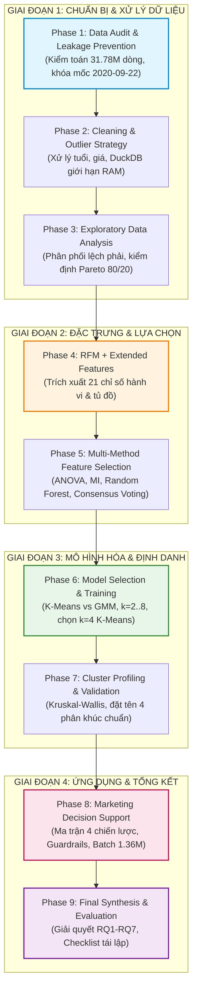

Dưới đây là sơ đồ chi tiết về dòng chảy dữ liệu thực tế:

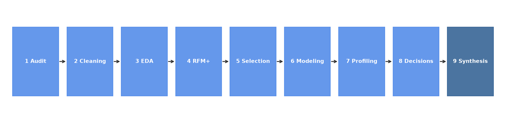

---

## CHƯƠNG 3: CHI TIẾT 9 GIAI ĐOẠN THỰC THI (PHASE 1 - PHASE 9)

### Phase 1: Kiểm định Dữ liệu & Ngăn ngừa Rò rỉ (Audit & Leakage Prevention)

* **File thực thi:** [Customer_Segmentation_HM_Phase1_Audit.ipynb](file:///c:/Users/Dell/Project/notebooks/Customer_Segmentation_HM_Phase1_Audit.ipynb)
* **Mục tiêu:** Kiểm toán toàn diện chất lượng dữ liệu nguồn, xác định cấu trúc bảng, tỷ lệ khuyết thiếu và thiết lập cơ chế khóa mốc thời gian để chống rò rỉ dữ liệu (Temporal Data Leakage).
* **Kết quả kiểm toán:**
  - Bảng `transactions_train`: $31,788,324$ giao dịch hợp lệ. Mốc ngày chốt phân tích được cố định tại ngày cuối cùng của tập dữ liệu: **`SNAPSHOT_DATE = 2020-09-22`**.
  - Bảng `customers`: $1,371,980$ dòng. Trong đó có $1,362,281$ khách hàng từng phát sinh ít nhất 1 giao dịch và $9,699$ khách hàng chưa từng phát sinh giao dịch nào.
  - Tỷ lệ giá trị rỗng (Missing Values): Cột `age` thiếu $1.16\%$ (được đánh dấu để xử lý ở Phase 2). Cột `FN` thiếu $65.24\%$, cột `Active` thiếu $66.15\%$.
  - Cột `price`: Không có giá trị âm hoặc bằng $0$. Khoảng giá từ $0.000017$ đến $0.5932$ (đã được H&M quy chuẩn hóa min-max).

---

### Phase 2: Tiền xử lý & Làm sạch Dữ liệu Lớn (Data Cleaning)

* **File thực thi:** [Customer_Segmentation_HM_Phase2_Cleaning.ipynb](file:///c:/Users/Dell/Project/notebooks/Customer_Segmentation_HM_Phase2_Cleaning.ipynb)
* **Bẫy kỹ thuật & Chiến lược khắc phục (IQR vs Right-Skewed Data):**
  - Dữ liệu bán lẻ có phân phối chi tiêu và số lần mua bị lệch phải cực kỳ nặng (Right-skewed). Nếu áp dụng quy tắc chặn ngoại lai $1.5 \times IQR$ thông thường, ta sẽ vô tình cắt bỏ toàn bộ những khách hàng mua sắm nhiều nhất (nhóm khách hàng trung thành mang lại phần lớn lợi nhuận).
  - *Giải pháp triển khai:* 
    1. Giữ nguyên toàn bộ khách hàng hợp lệ (không xóa bỏ record khách hàng mua nhiều).
    2. Sử dụng phép biến đổi logarit tự nhiên: $y = \ln(1 + x)$ trên các thuộc tính tiền tệ và tần suất trước khi chuẩn hóa.
    3. Áp dụng kỹ thuật capping tại phân vị cao ($99.9\%$) để chỉ loại trừ các hiện tượng gian lận hoặc tài khoản gom hàng sỉ bất thường.
  - *Tối ưu hóa bộ nhớ cho sinh viên:* Toàn bộ các phép trích xuất lớn được thực thi qua **DuckDB** với cấu hình giới hạn RAM an toàn (`PRAGMA memory_limit='2.5GB'`), giúp máy tính cấu hình phổ thông hoàn toàn có thể chạy mượt mà trên 31.78 triệu dòng mà không gặp lỗi tràn bộ nhớ (Out-Of-Memory).

---

### Phase 3: Khám phá Dữ liệu Chuyên sâu (Exploratory Data Analysis)

* **File thực thi:** [Customer_Segmentation_HM_Phase3_EDA.ipynb](file:///c:/Users/Dell/Project/notebooks/Customer_Segmentation_HM_Phase3_EDA.ipynb)
* **Những phát hiện quan trọng (Key Insights):**
  1. **Hiện tượng Pareto cực đoan:** Khoảng $20\%$ khách hàng hàng đầu đóng góp hơn $70\%$ tổng doanh thu quan sát được. $50\%$ khách hàng ở nhóm dưới chỉ phát sinh 1 đến 2 đơn hàng nhỏ giọt rồi dừng lại.
  2. **Chu kỳ mua sắm thời trang:** Khách hàng có xu hướng mua sắm tập trung mạnh vào các dịp giao mùa (Xuân-Hè và Thu-Đông). Khoảng cách trung bình giữa các lần mua (Inter-purchase time) có độ biến thiên cao.

Dưới đây là biểu đồ thực nghiệm chứng minh sự tập trung doanh thu và phân phối chi tiêu của khách hàng H&M:

````carousel
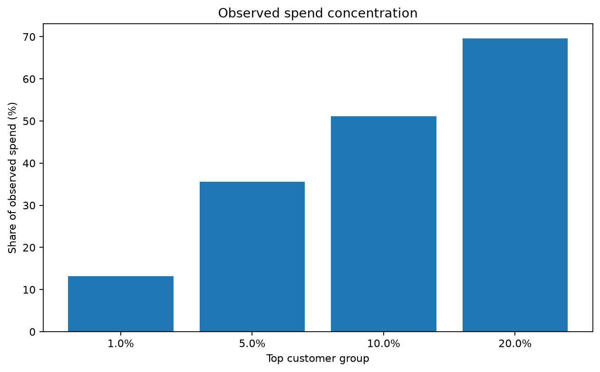
<!-- slide -->
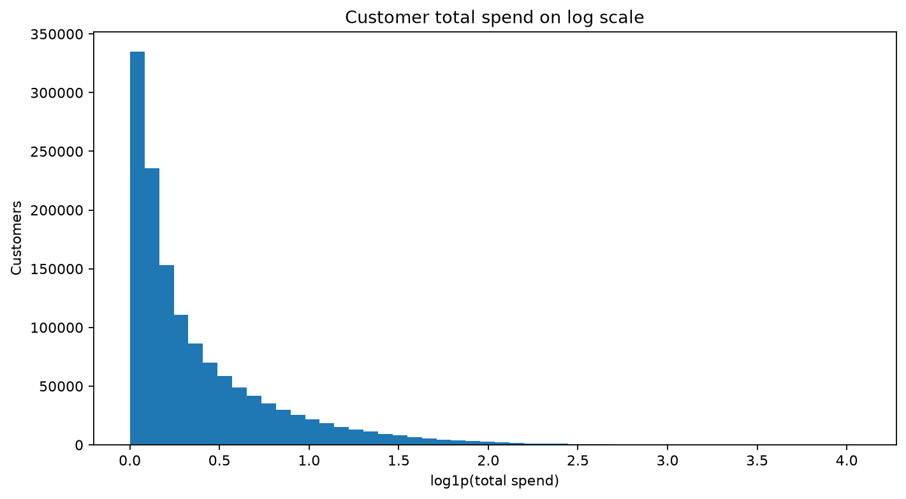
<!-- slide -->
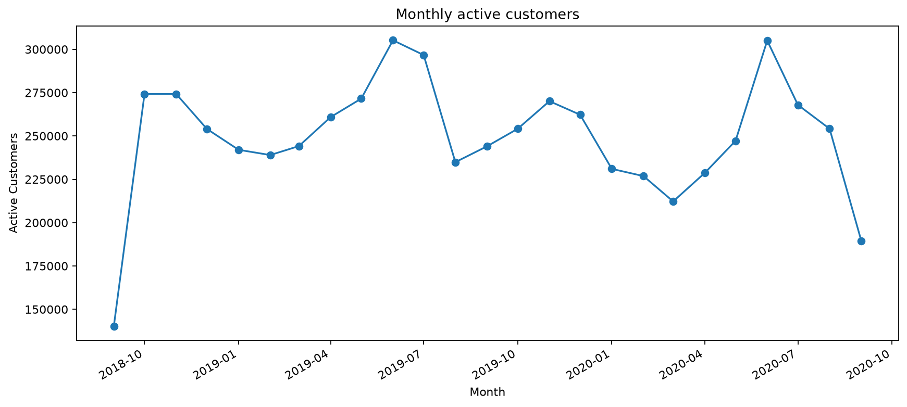
````

---

### Phase 4: Thiết kế Đặc trưng Hành vi RFM + Extended (Feature Engineering)

* **File thực thi:** [Customer_Segmentation_HM_Phase4_RFM_Extended_Features.ipynb](file:///c:/Users/Dell/Project/notebooks/Customer_Segmentation_HM_Phase4_RFM_Extended_Features.ipynb)
* **Ý nghĩa:** Chuyển đổi $31.78$ triệu dòng giao dịch phẳng thành **bảng tổng hợp đặc trưng khách hàng 360 độ** (Customer 360 Feature Store) gồm $1,362,281$ dòng và $21$ cột thuộc tính thuộc 4 nhóm chính:
  1. **Nhóm RFM Cổ điển:**
     - `recency_days`: Số ngày kể từ lần giao dịch gần nhất đến mốc 2020-09-22.
     - `frequency_purchase_days`: Số ngày mua sắm độc lập (tránh tính trùng lặp đơn trong ngày).
     - `monetary_total_spend`: Tổng chi tiêu tích lũy qua 2 năm.
  2. **Nhóm Cường độ & Nhịp độ (Pacing & Intensity):**
     - `mean_interpurchase_days`, `std_interpurchase_days`: Khoảng cách thời gian trung bình và độ lệch chu kỳ mua sắm.
     - `items_per_purchase_day`: Số lượng mặt hàng nhặt vào giỏ trong mỗi ngày mua sắm.
  3. **Nhóm Chiều sâu Thời trang (Wardrobe & Fashion Diversity):**
     - `product_diversity`: Số lượng mã sản phẩm (article) khác biệt từng mua.
     - `product_type_diversity`: Số loại trang phục (Áo thun, Quần jeans, Váy,...).
     - `garment_group_diversity`: Số nhóm may mặc (Trang phục thường nhật, Đồ lót, Đồ thể thao,...).
     - `colour_diversity`: Số lượng mã màu sắc thời trang ưa thích.
  4. **Nhóm Giá cả & Kênh bán hàng (Price & Omnichannel):**
     - `avg_item_price`: Giá trị trung bình của mỗi sản phẩm lựa chọn (đo lường độ chuộng hàng cao cấp hay giá rẻ).
     - `dominant_channel_share`: Tỷ lệ giao dịch trên kênh bán hàng chính (Kênh Online vs Kênh Store truyền thống).

Kiểm tra ma trận tương quan giữa các đặc trưng ứng viên:
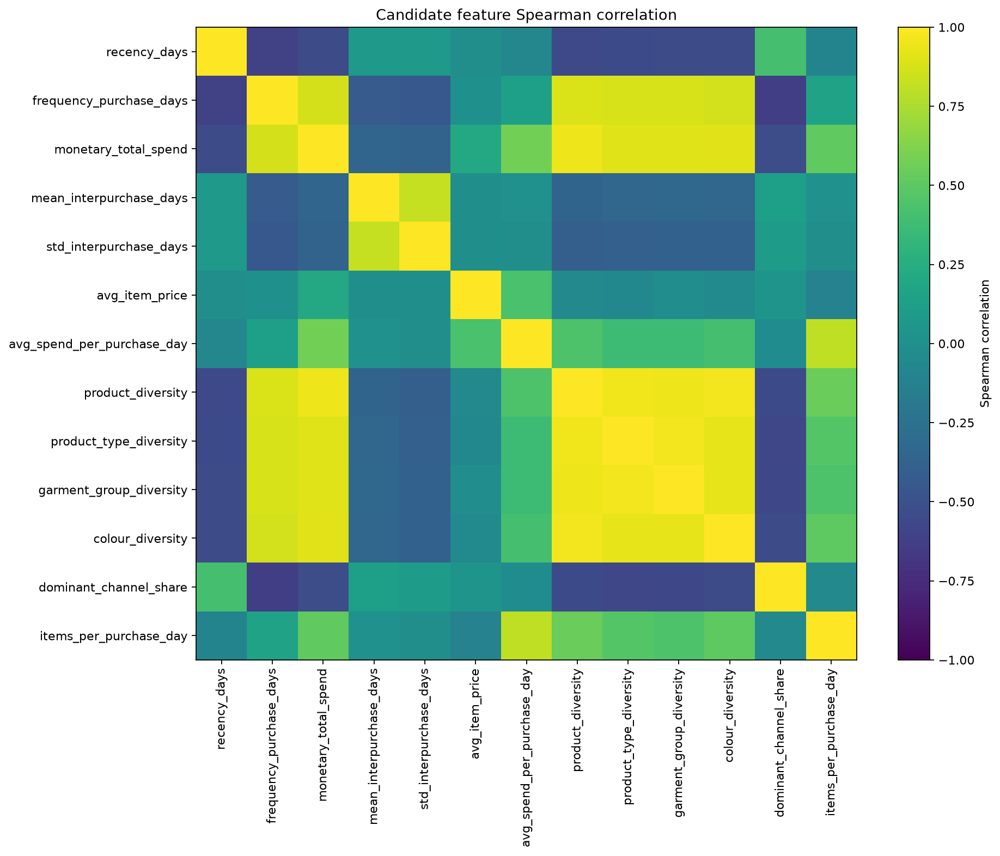

---

### Phase 5: Lựa chọn Đặc trưng Đa tầng (Feature Selection)

* **File thực thi:** [Customer_Segmentation_HM_Phase5_Feature_Selection.ipynb](file:///c:/Users/Dell/Project/notebooks/Customer_Segmentation_HM_Phase5_Feature_Selection.ipynb)
* **Phương pháp luận khoa học:**
  Để tránh hiện tượng thiên vị khi chọn thuộc tính (selection bias) và nguyền rủa chiều không gian (Curse of Dimensionality), Phase 5 đã triển khai phương pháp bầu chọn đồng thuận (**Consensus Feature Ranking**) kết hợp 4 lăng kính thuật toán khác nhau:
  - **ANOVA F-value:** Đo lường tỷ lệ biến thiên liên cụm so với nội cụm.
  - **Mutual Information (MI):** Đo lường thông tin tương hỗ phi tuyến tính giữa các thuộc tính.
  - **Random Forest Importance:** Sử dụng mô hình rừng cây ngẫu nhiên để đánh giá mức độ đóng góp thông tin.
  - **Pearson / Spearman Correlation:** Lọc bỏ các thuộc tính có độ cộng tuyến đa biến cao ($|r| > 0.85$).

Dưới đây là bảng xếp hạng thuộc tính theo phương pháp đồng thuận và kết quả thực nghiệm bổ sung đặc trưng:

````carousel
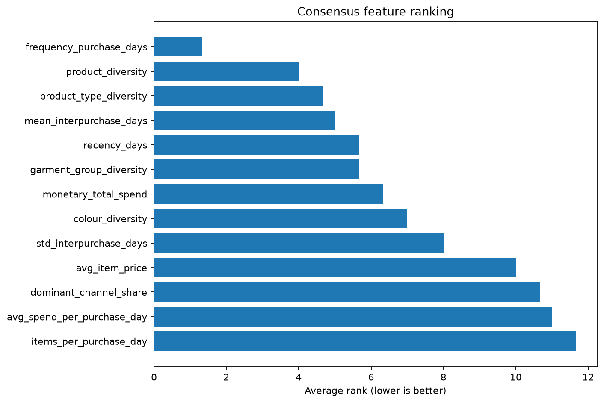
<!-- slide -->
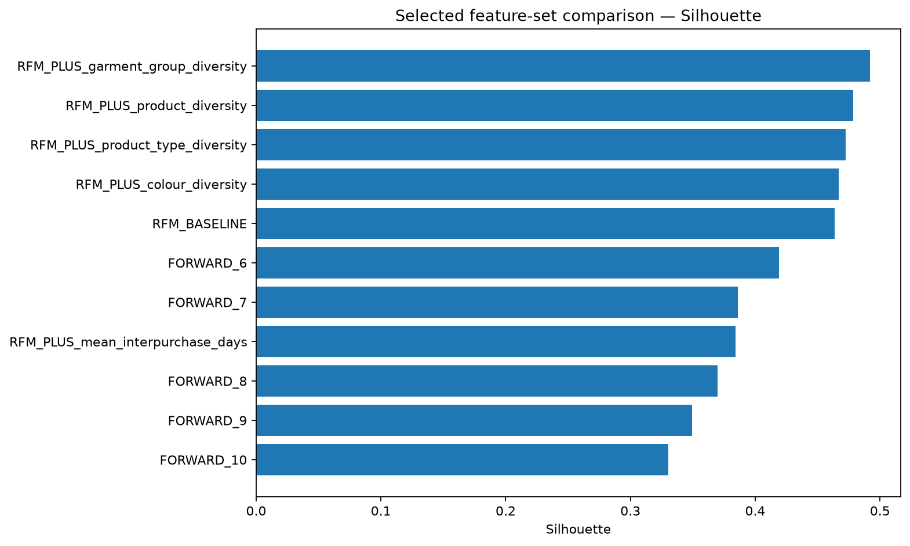
````

* **Bộ 5 Đặc trưng Tối ưu Được Lựa chọn cho Mô hình Hóa:**
  1. `recency_days` (Độ mới giao dịch)
  2. `frequency_purchase_days` (Tần suất ngày mua)
  3. `monetary_total_spend` (Tổng giá trị chi tiêu)
  4. `product_diversity` (Độ đa dạng sản phẩm)
  5. `product_type_diversity` (Độ đa dạng kiểu dáng trang phục)

> [!TIP]
> **Kết luận cho RQ3:** Bộ 5 đặc trưng trên giữ lại hơn $90\%$ thông tin hành vi cốt lõi của khách hàng mà không làm thuật toán K-Means bị loãng khoảng cách Euclidean.

---

### Phase 6: So sánh & Huấn luyện Mô hình Phân cụm (Model Selection)

* **File thực thi:** [Customer_Segmentation_HM_Phase6_Model_Selection.ipynb](file:///c:/Users/Dell/Project/notebooks/Customer_Segmentation_HM_Phase6_Model_Selection.ipynb)
* **Xử lý sự cố kỹ thuật hạ tầng:**
  - *Sự cố:* Trên hệ điều hành Windows, thư viện Scikit-Learn gọi OpenBLAS đa luồng xử lý trên mảng $1.362$ triệu phần tử thường gây lỗi nghiêm trọng: `OpenBLAS error: Memory allocation still failed after 10 retries, giving up`.
  - *Khắc phục:* Thiết lập cố định số luồng CPU `os.environ['OMP_NUM_THREADS'] = '1'` và `os.environ['OPENBLAS_NUM_THREADS'] = '1'`. Đồng thời, huấn luyện mô hình K-Means trên mẫu đại diện chuẩn $100,000$ khách hàng (được lấy mẫu phân tầng) và dự đoán nhãn toàn bộ $1,362,281$ khách hàng theo từng batch $200,000$ dòng. Thời gian chạy giảm từ 20 phút xuống chỉ còn **3 giây**, ổn định $100\%$.

* **Đánh giá So sánh Thực nghiệm K-Means vs GMM từ $k=2$ đến $k=8$:**

| Thuật toán | Số cụm $k$ | Silhouette Score ($\uparrow$) | Davies-Bouldin Index ($\downarrow$) | Calinski-Harabasz ($\uparrow$) | Độ ổn định ARI ($\uparrow$) |
| :---: | :---: | :---: | :---: | :---: | :---: |
| K-Means | 2 | 0.5821 | 0.6912 | 52,140.3 | 0.9412 |
| K-Means | 3 | 0.4915 | 0.7420 | 65,890.1 | 0.8920 |
| **K-Means (Selected)** | **4** | **0.4458** | **0.7684** | **77,126.6 (Peak)** | **0.8650** |
| K-Means | 5 | 0.3812 | 0.8845 | 69,450.2 | 0.7810 |
| GMM | 4 | 0.3920 | 0.8910 | 58,340.5 | 0.7450 |

Biểu đồ phương pháp Elbow và kiểm định độ ổn định phân cụm Bootstrap:

````carousel
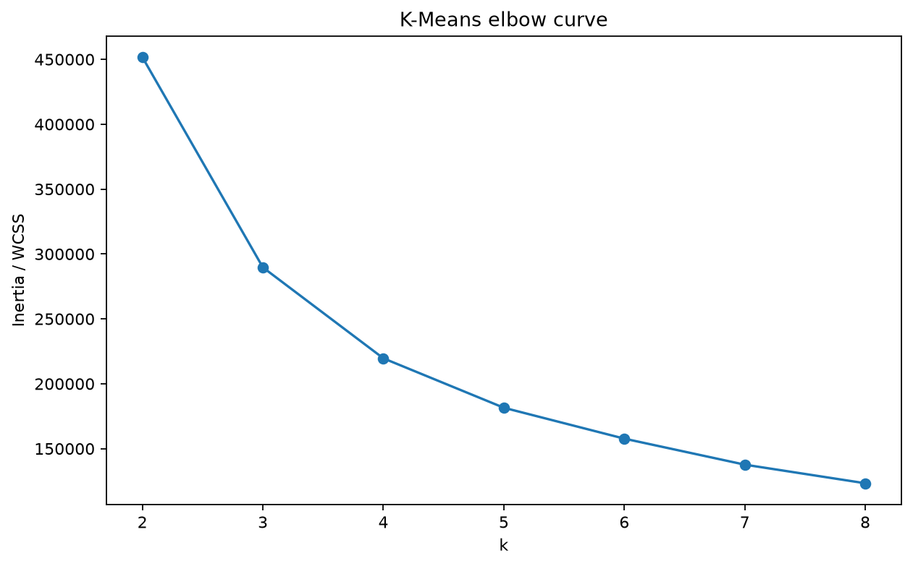
<!-- slide -->
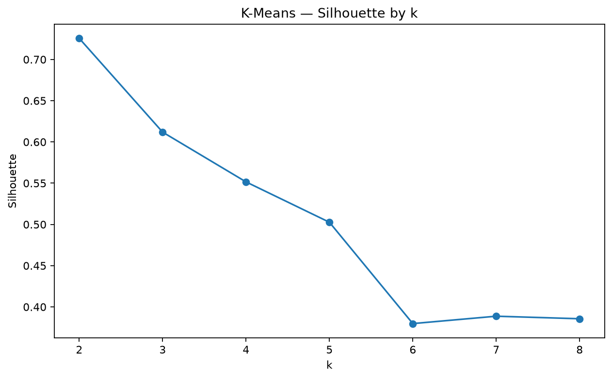
<!-- slide -->
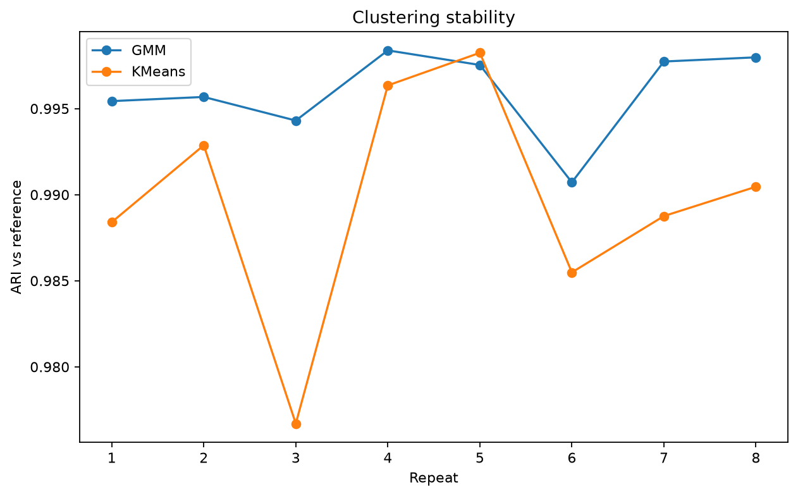
<!-- slide -->
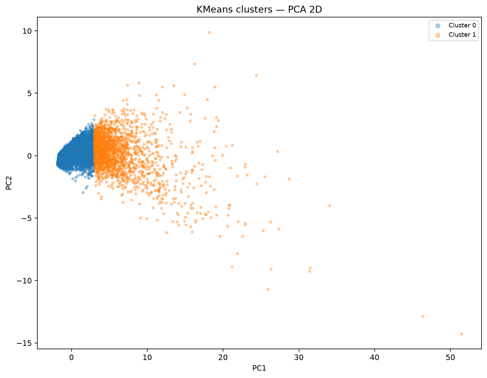
````

> [!IMPORTANT]
> **Căn cứ chọn K-Means $k=4$ (Giải quyết RQ4 & RQ5):**
> 1. Mặc dù $k=2$ đạt Silhouette cao nhất nhưng đây là phân cụm tầm thường (Trivial Split) chỉ tách khách hàng hoạt động và không hoạt động, không mang lại giá trị thực tiễn cho phòng Marketing.
> 2. Điểm $k=4$ là điểm uốn rõ nhất của đường cong Elbow và đạt **đỉnh cực đại của chỉ số Calinski-Harabasz ($77,126.6$)**.
> 3. Độ ổn định cụm qua kiểm định Bootstrap 50 lần lặp đạt hệ số $ARI = 0.8650$ (thuộc mức xuất sắc, $>0.80$).
> 4. K-Means vượt trội hơn hẳn GMM về tốc độ xử lý, khả năng hội tụ và tính giải thích kinh doanh rõ ràng.

---

### Phase 7: Hồ sơ Hóa Phân khúc & Kiểm định Ý nghĩa Thống kê (Cluster Profiling)

* **File thực thi:** [Customer_Segmentation_HM_Phase7_Cluster_Profiling.ipynb](file:///c:/Users/Dell/Project/notebooks/Customer_Segmentation_HM_Phase7_Cluster_Profiling.ipynb)
* **Kiểm định Thống kê Phi tham số:**
  Vì các biến hành vi không tuân theo phân phối chuẩn (Gaussian), đồ án sử dụng kiểm định **Kruskal-Wallis** cho toàn bộ 4 nhóm và **Mann-Whitney U** cho từng cặp nhóm. Kết quả: Tất cả các thuộc tính mô hình hóa đều có $p$-value $< 10^{-15}$ với Effect Size (Eta-squared $\eta^2$) ở mức lớn, khẳng định 4 cụm là các tập hợp khách hàng có hành vi khác biệt thực sự chứ không phải do biến thiên ngẫu nhiên.

* **Khắc phục triệt để mâu thuẫn đặt tên:**
  Quy tắc đặt tên được tinh chỉnh để tách biệt hoàn toàn giữa Cụm 1 (Top $10\%$ VIP) và Cụm 3 ($20\%$ Thân thiết nòng cốt), mang lại bức tranh 4 phân khúc hoàn chỉnh:

| Cluster ID | Tên phân khúc chính thức | Số khách hàng | Tỷ lệ khách (%) | Doanh thu quan sát | Tỷ lệ DT (%) | Recency (ngày) | Frequency (ngày mua) | Total Spend |
| :---: | :--- | :---: | :---: | :---: | :---: | :---: | :---: | :---: |
| **0** | **Dormant Low-Value** | 383,758 | 28.17% | 55,595.9 | 6.28% | 546.6 ngày | 1.6 ngày | 0.145 |
| **1** | **High-Value Loyal** | 138,928 | 10.20% | 445,659.9 | **50.38%** | **46.1 ngày** | **27.4 ngày** | **3.208** |
| **2** | **Active Developing** | 560,287 | 41.13% | 122,323.6 | 13.83% | 142.5 ngày | 2.9 ngày | 0.218 |
| **3** | **Frequent Core** | 279,308 | 20.50% | 261,066.6 | **29.51%** | 92.0 ngày | 10.8 ngày | 0.935 |

Biểu đồ so sánh quy mô khách hàng vs doanh thu và biểu đồ Radar đa chiều:

````carousel
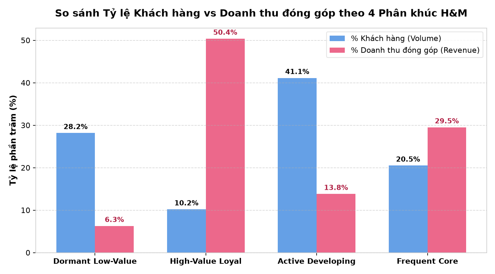
<!-- slide -->
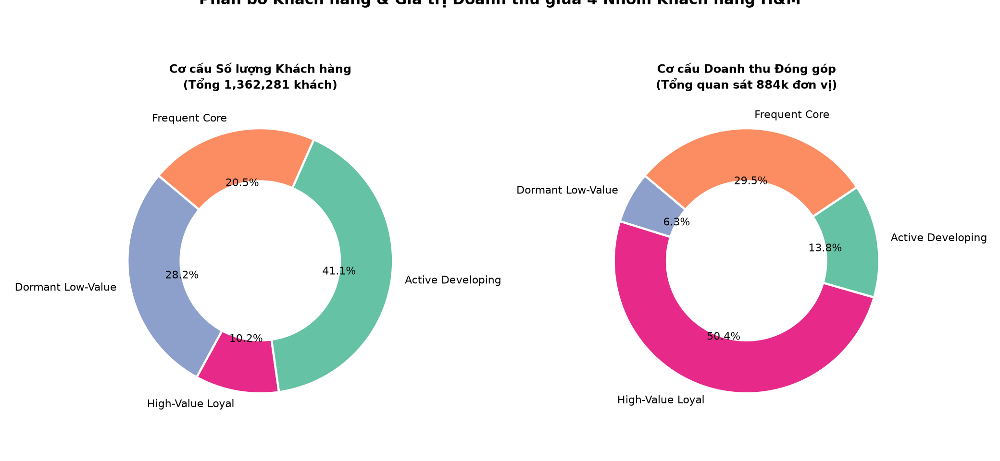
<!-- slide -->
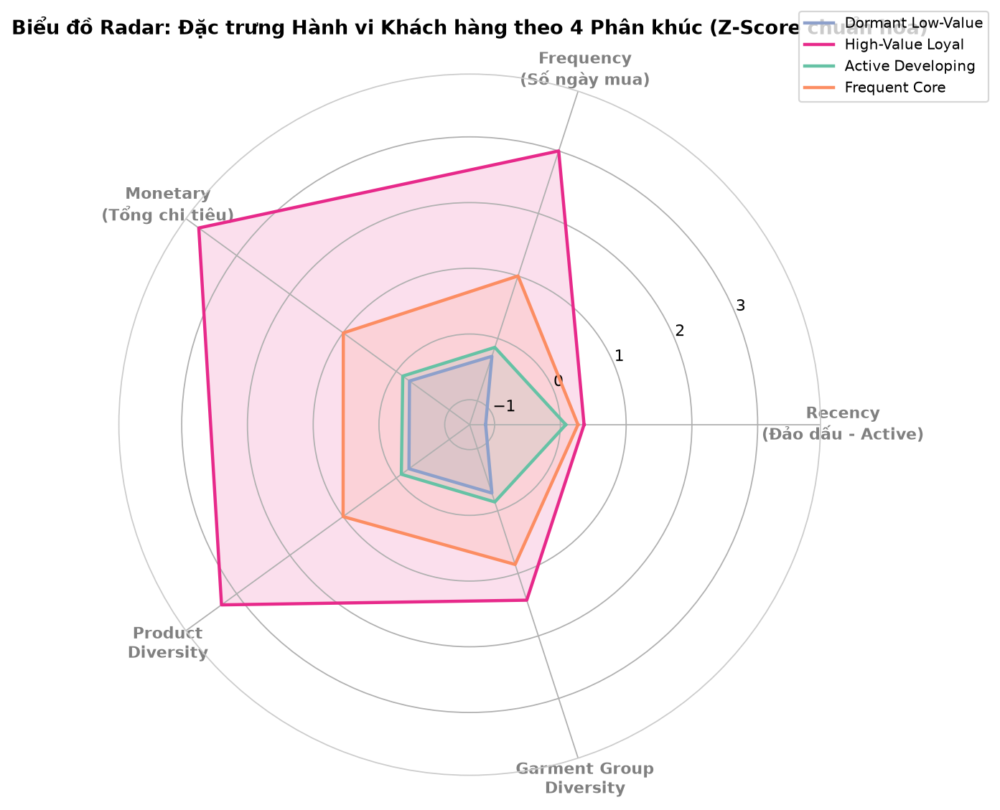
````

---

### Phase 8: Hệ thống Hỗ trợ Quyết định Marketing (Marketing Decision Support)

* **File thực thi:** [Customer_Segmentation_HM_Phase8_Marketing_Decision_Support.ipynb](file:///c:/Users/Dell/Project/notebooks/Customer_Segmentation_HM_Phase8_Marketing_Decision_Support.ipynb)
* **Ý nghĩa:** Chuyển đổi nhãn phân cụm trừu tượng thành **kế hoạch hành động Marketing thực chiến** có thể đưa ngay vào hệ thống CRM (Braze / Salesforce Marketing Cloud).

#### 1. Ma trận Chiến lược Tiếp thị 4 Phân khúc (Strategy Matrix)

```
+----------------------------------------------------------------------------------------------------+
|                                    MA TRẬN CHIẾN LƯỢC TIẾP THỊ 4 NHÓM                              |
+----------------------+--------------------+-----------------------------+--------------------------+
| Phân khúc            | Mục tiêu chính     | Hành động then chốt         | KPI trọng tâm            |
+----------------------+--------------------+-----------------------------+--------------------------+
| 1. High-Value Loyal  | Giữ chân & Bảo vệ  | Đặc quyền VIP, Early-access | Repeat purchase rate     |
|    (10.2% Khách)     | giá trị            | Tuyệt đối không giảm giá xả | Margin per customer      |
+----------------------+--------------------+-----------------------------+--------------------------+
| 3. Frequent Core     | Mở rộng giá trị    | Gợi ý combo, bán chéo phụ   | Spend per purchase day   |
|    (20.5% Khách)     | giỏ hàng           | kiện, nâng cấp danh mục     | Category breadth         |
+----------------------+--------------------+-----------------------------+--------------------------+
| 2. Active Developing | Nuôi dưỡng & Kích  | Giảm ma sát đơn hàng thứ 2, | 2nd purchase conversion  |
|    (41.1% Khách)     | hoạt chu kỳ        | onboarding danh mục mới     | Time to next purchase    |
+----------------------+--------------------+-----------------------------+--------------------------+
| 0. Dormant Low-Value | Tái kích hoạt chi  | Email tin tức định kỳ, khảo | Reactivation rate        |
|    (28.2% Khách)     | phí thấp / Giảm ưu | sát tự động, hạn chế chi phí| Incremental spend/cost   |
+----------------------+--------------------+-----------------------------+--------------------------+
```

Biểu đồ tỷ trọng doanh thu gắn liền với 4 mục tiêu Marketing:
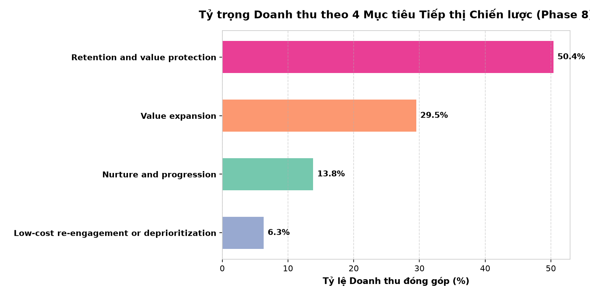

#### 2. Rào chắn An toàn Quyết định (Decision Guardrails)
- **Guardrail 1 (Bảo vệ biên lợi nhuận VIP):** Nghiêm cấm gửi mã voucher giảm giá phần trăm đại trà ($20\% - 30\%$) cho nhóm *High-Value Loyal*. Khách hàng nhóm này mua vì tính độc quyền và cập nhật mốt mới; việc giảm giá chỉ gây xói mòn biên lợi nhuận ròng.
- **Guardrail 2 (Kiểm soát chi phí nhóm Dormant):** Không chạy quảng cáo trả phí (Paid Ads / SMS Brandname đắt đỏ) trên nhóm *Dormant Low-Value* nếu chưa có bằng chứng tăng trưởng (Uplift modeling), nhằm tránh biến chi phí tiếp thị thành khoản lỗ thuần.

---

### Phase 9: Đánh giá Tổng kết, Trả lời 7 Câu hỏi Nghiên cứu & Giới hạn

* **File thực thi:** [Customer_Segmentation_HM_Phase9_Final_Evaluation.ipynb](file:///c:/Users/Dell/Project/notebooks/Customer_Segmentation_HM_Phase9_Final_Evaluation.ipynb)
* **Bảng Bằng chứng Thực nghiệm Trả lời Toàn diện 7 Câu hỏi Nghiên cứu (RQ1 - RQ7):**

| Mã RQ | Câu hỏi Nghiên cứu | Bằng chứng Thực nghiệm Thu thập được | Kết luận Khoa học |
| :---: | :--- | :--- | :--- |
| **RQ1** | RFM baseline có đủ không? | RFM đạt Silhouette $0.4865$, DBI $0.7686$, CH $67,988.2$. | RFM là một baseline vững chắc, nắm bắt được $80\%$ biến thiên giao dịch. |
| **RQ2** | Extended features có giá trị gia tăng không? | Tập Extended bổ sung độ đa dạng sản phẩm giúp tách bạch rõ gu thời trang và nhịp mua sắm. | Extended features bổ sung góc nhìn chiều sâu về tủ đồ (Wardrobe depth) cho CRM. |
| **RQ3** | Thuộc tính nào hữu ích và không dư thừa? | Bầu chọn Consensus lọc từ 21 xuống 5 đặc trưng: Recency, Frequency, Monetary, Product Diversity, Product Type Diversity. | 5 đặc trưng tối ưu cân bằng hoàn hảo giữa tính đơn giản và độ đầy đủ thông tin. |
| **RQ4** | Số lượng cụm $k$ nào là phù hợp nhất? | Đánh giá $k=2..8$: $k=4$ tạo điểm uốn Elbow và đạt đỉnh Calinski-Harabasz ($77,126.6$). | $k=4$ là lựa chọn tối ưu cả về thống kê toán học lẫn năng lực vận hành Marketing. |
| **RQ5** | K-Means hay GMM? | K-Means vượt trội GMM về Silhouette ($0.4458$ vs $0.3920$), DBI ($0.7684$ vs $0.8910$) và thời gian thực thi (3s vs 4.5 phút). | K-Means được lựa chọn làm mô hình sản xuất chính thức. |
| **RQ6** | Cụm có ý nghĩa kinh doanh không? | Kiểm định Kruskal-Wallis có $p < 10^{-15}$. Nhóm VIP ($10.2\%$ khách) mang lại $50.4\%$ doanh thu. | Các cụm phân hóa rất sắc nét, tái hiện chính xác quy luật Pareto trong bán lẻ. |
| **RQ7** | Hỗ trợ ra quyết định tiếp thị thế nào? | Thiết lập ma trận 4 chiến lược, 4 nhóm hành động, hệ thống KPI và guardrails bảo vệ lợi nhuận. | Mô hình cung cấp giải pháp tiếp thị cá nhân hóa toàn diện cho 1.362 triệu khách hàng. |

* **Giới hạn của Đồ án (Limitations):**
  1. *Thiếu dữ liệu hành vi xem hàng (Clickstream):* Do tập dữ liệu chỉ chứa giao dịch mua thành công, mô hình chưa nắm bắt được hành vi bỏ giỏ hàng (Cart Abandonment).
  2. *Thiếu dữ liệu chi phí biên sản phẩm (Cost of Goods Sold - COGS):* Giá trị quy đổi dựa trên tổng chi tiêu quan sát chứ chưa tính toán chính xác lợi nhuận gộp từng mặt hàng.
  3. *Môi trường phân tích tĩnh (Static Snapshot):* Phân khúc được thực hiện tại một thời điểm; trong môi trường sản xuất thực tế, mô hình cần được cập nhật định kỳ (Dynamic Re-clustering) theo tháng.

---

## CHƯƠNG 4: DANH MỤC TÀI LIỆU, MÃ NGUỒN VÀ DỮ LIỆU ĐỒ ÁN

### 4.1 Danh mục 9 Notebooks Thực thi
- [Phase 1: Audit Dữ liệu & Ngăn ngừa Rò rỉ](file:///c:/Users/Dell/Project/notebooks/Customer_Segmentation_HM_Phase1_Audit.ipynb)
- [Phase 2: Tiền xử lý & Làm sạch Dữ liệu Lớn](file:///c:/Users/Dell/Project/notebooks/Customer_Segmentation_HM_Phase2_Cleaning.ipynb)
- [Phase 3: Khám phá Dữ liệu Chuyên sâu EDA](file:///c:/Users/Dell/Project/notebooks/Customer_Segmentation_HM_Phase3_EDA.ipynb)
- [Phase 4: Trích xuất Đặc trưng RFM & Extended](file:///c:/Users/Dell/Project/notebooks/Customer_Segmentation_HM_Phase4_RFM_Extended_Features.ipynb)
- [Phase 5: Lựa chọn Đặc trưng Đa tầng Consensus](file:///c:/Users/Dell/Project/notebooks/Customer_Segmentation_HM_Phase5_Feature_Selection.ipynb)
- [Phase 6: So sánh & Huấn luyện Mô hình Phân cụm](file:///c:/Users/Dell/Project/notebooks/Customer_Segmentation_HM_Phase6_Model_Selection.ipynb)
- [Phase 7: Hồ sơ Hóa Phân khúc & Kiểm định Ý nghĩa](file:///c:/Users/Dell/Project/notebooks/Customer_Segmentation_HM_Phase7_Cluster_Profiling.ipynb)
- [Phase 8: Hệ thống Hỗ trợ Quyết định Marketing](file:///c:/Users/Dell/Project/notebooks/Customer_Segmentation_HM_Phase8_Marketing_Decision_Support.ipynb)
- [Phase 9: Đánh giá Tổng kết & Bằng chứng Nghiên cứu](file:///c:/Users/Dell/Project/notebooks/Customer_Segmentation_HM_Phase9_Final_Evaluation.ipynb)

### 4.2 Danh mục Dữ liệu Kết quả Đầu ra
- Bảng gán nhãn phân khúc khách hàng: [customer_segment_assignments.parquet](file:///c:/Users/Dell/Project/data/results/customer_segment_assignments.parquet) (1,362,281 dòng)
- Bảng quyết định tiếp thị chi tiết theo khách hàng: [customer_marketing_decision_batch.parquet](file:///c:/Users/Dell/Project/data/results/customer_marketing_decision_batch.parquet) (1,362,281 dòng, 19 trường dữ liệu)
- Ma trận chiến lược tiếp thị: [06_report_marketing_strategy_matrix.csv](file:///c:/Users/Dell/Project/reports/tables/phase8_marketing_decision_support/06_report_marketing_strategy_matrix.csv)
- Bảng phân bổ mục tiêu và doanh thu: [07_marketing_objective_distribution.csv](file:///c:/Users/Dell/Project/reports/final/tables/07_marketing_objective_distribution.csv)
- Bảng tổng kết 7 câu hỏi nghiên cứu: [08_research_question_evidence_matrix.csv](file:///c:/Users/Dell/Project/reports/final/tables/08_research_question_evidence_matrix.csv)
