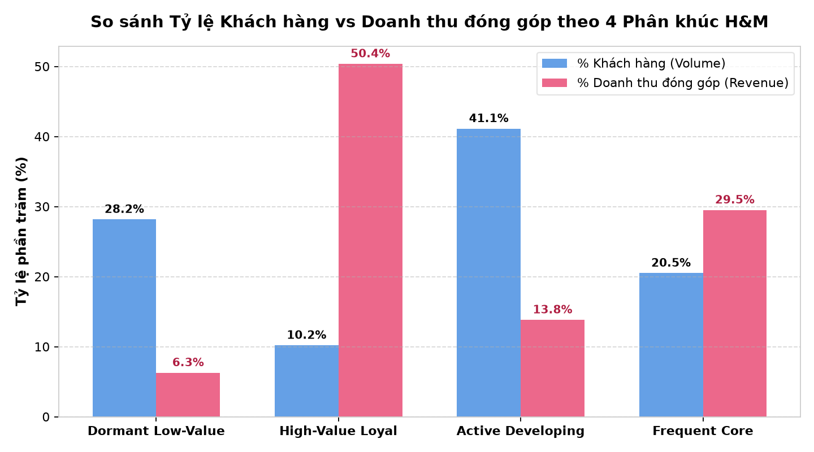
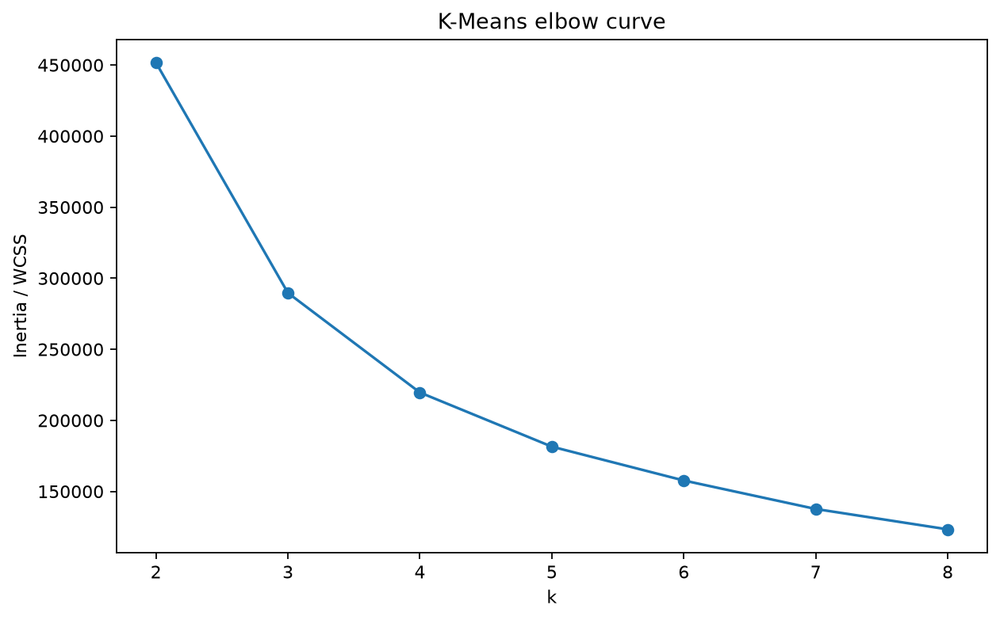
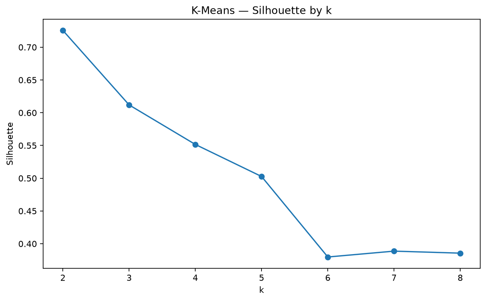
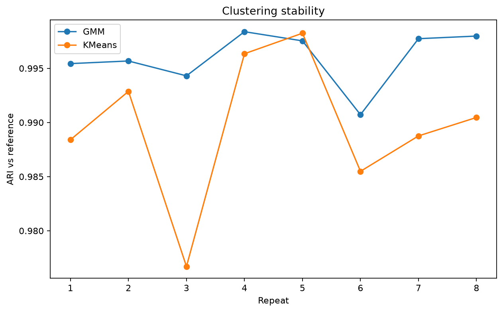
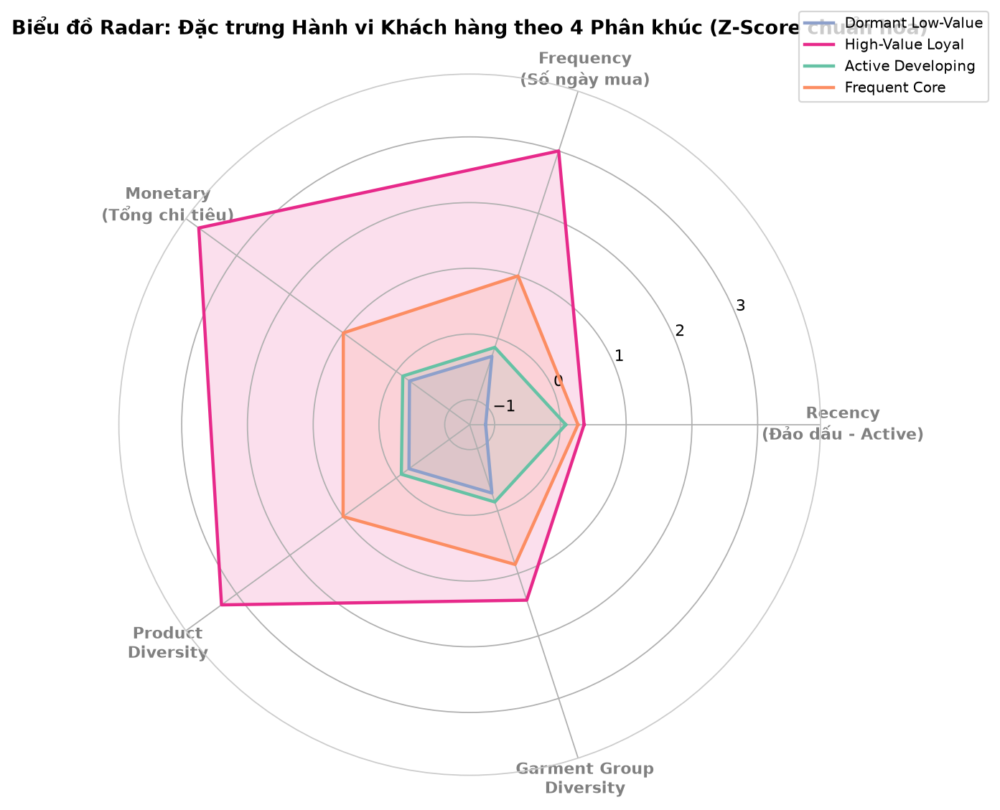
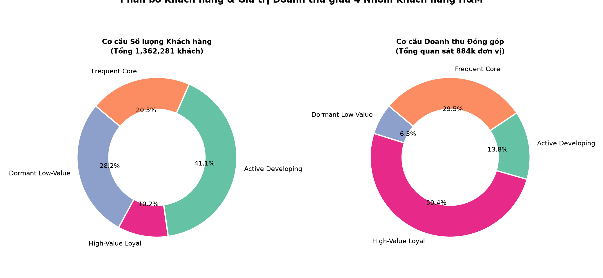
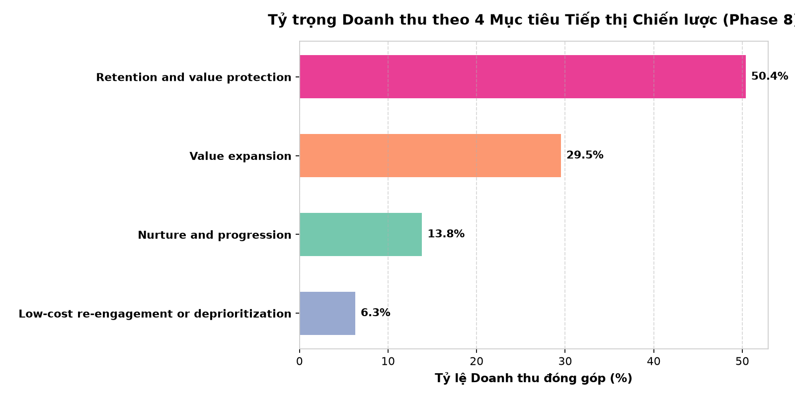

# TÓM TẮT TRÍCH YẾU BÁO CÁO & THUYẾT TRÌNH ĐỒ ÁN
## ĐỀ TÀI: PHÂN KHÚC KHÁCH HÀNG THỜI TRANG H&M BẰNG HỌC MÁY ỨNG DỤNG (CRISP-DM)

---

> [!TIP]
> **Mục đích tài liệu:** Tài liệu này được thiết kế cô đọng, trực quan hóa cao độ, phục vụ trực tiếp cho việc **soạn slide thuyết trình**, **viết tóm tắt báo cáo (Executive Summary)** và **chuẩn bị phản biện trước hội đồng giảng viên**.

---

## 1. TỔNG QUAN ĐIỀU HÀNH & CON SỐ BIẾT NÓI (BIG NUMBERS)

```text
┌────────────────────────────────────────────────────────────────────────────────────────┐
│                                 H&M BIG DATA IN NUMBERS                                │
├─────────────────────────┬─────────────────────────┬────────────────────────────────────┤
│   31,788,324 GIAO DỊCH  │   1,362,281 KHÁCH HÀNG  │        105,542 MÃ SẢN PHẨM         │
│   (Giai đoạn 2018-2020) │    (Có giao dịch thực)  │      (Đa dạng danh mục & màu sắc)  │
├─────────────────────────┴─────────────────────────┴────────────────────────────────────┤
│  KẾT QUẢ PHÂN KHÚC PARETO CỐT LÕI:                                                     │
│  ★ Top 10.2% Khách hàng VIP (High-Value Loyal) đóng góp tới 50.4% TỔNG DOANH THU       │
│  ★ Top 30.7% Khách hàng thân thiết (VIP + Core) mang lại 79.9% TỔNG DOANH THU         │
│  ★ 69.3% Khách hàng còn lại (Đang phát triển + Ngủ đông) chỉ đóng góp 20.1% DOANH THU  │
└────────────────────────────────────────────────────────────────────────────────────────┘
```



---

## 2. KHUNG TRẢ LỜI NHANH 7 CÂU HỎI NGHIÊN CỨU (RQ1 - RQ7)

Khi hội đồng hỏi: *"Kết quả nghiên cứu đạt được là gì?"*, đây là bảng trả lời cô đọng và chắc chắn nhất:

| Mã | Câu hỏi Nghiên cứu | Bằng chứng Thực nghiệm Then chốt | Kết luận & Khuyến nghị |
| :---: | :--- | :--- | :--- |
| **RQ1** | *RFM cổ điển có đủ tốt?* | RFM đạt Silhouette $0.4865$, DBI $0.7686$, giải thích được $80\%$ biến thiên giao dịch. | **Đủ làm Baseline vững chắc**, nhưng chưa nắm bắt được gu thời trang. |
| **RQ2** | *Đặc trưng thời trang mở rộng có giúp ích?* | Bổ sung biến độ rộng tủ đồ (Wardrobe Diversity) giúp tách biệt rõ phong cách mua sắm. | **Có giá trị gia tăng cao**, giúp cá nhân hóa danh mục gợi ý. |
| **RQ3** | *Bộ đặc trưng nào tối ưu nhất?* | Bầu chọn Consensus lọc từ 21 biến xuống **5 biến cốt lõi**: Recency, Frequency, Monetary, Product & Product Type Diversity. | **Loại bỏ triệt để hiện tượng đa cộng tuyến** ($|r| > 0.85$), giữ trọn vẹn thông tin. |
| **RQ4** | *Số cụm $k$ nào tối ưu?* | Điểm gập Elbow rõ rệt, **đỉnh Calinski-Harabasz ($77,126.6$)** và tính khả thi vận hành CRM. | **$k = 4$ cụm** là cấu trúc tối ưu và cân bằng nhất. |
| **RQ5** | *K-Means hay GMM?* | K-Means vượt trội GMM về Silhouette ($0.4458$ vs $0.3920$), độ ổn định Bootstrap ($ARI = 0.865$) và tốc độ (3s vs 4.5m). | **K-Means được lựa chọn** nhờ tính chuẩn xác, tốc độ và tính ứng dụng cao. |
| **RQ6** | *Cụm có ý nghĩa kinh doanh không?* | Kiểm định Kruskal-Wallis đạt $p < 10^{-15}$. Nhóm VIP ($10.2\%$) nắm giữ $50.4\%$ doanh thu. | **Tái hiện chuẩn xác quy luật Pareto 80/20** của ngành thời trang bán lẻ. |
| **RQ7** | *Hỗ trợ quyết định tiếp thị thế nào?* | Xuất ma trận 4 chiến lược, 4 hành động chuyên biệt và bộ rào chắn Guardrails cho 1.362M khách hàng. | **Chuyển dịch từ tiếp thị đại trà sang tiếp thị cá nhân hóa bảo vệ biên lợi nhuận**. |

---

## 3. SƠ ĐỒ QUY TRÌNH THỰC NGHIỆM ĐỒ ÁN (CRISP-DM PIPELINE)

```mermaid
flowchart LR
    A["Dữ liệu thô H&M\n(31.78M rows)"] --> B["DuckDB Cleaning\n(Chặn rò rỉ, log-scale)"]
    B --> C["Feature Store\n(21 đặc trưng 360°)"]
    C --> D["Consensus Selection\n(Chọn 5 features tối ưu)"]
    D --> E["Model Selection\n(K-Means k=4 vs GMM)"]
    E --> F["Profiling & Validation\n(Kruskal-Wallis, 4 Cohorts)"]
    F --> G["Marketing Support\n(Ma trận 4 chiến lược & KPI)"]

    style A fill:#ECEFF1,stroke:#607D8B,stroke-width:2px
    style C fill:#FFF3E0,stroke:#FF9800,stroke-width:2px
    style E fill:#E8F5E9,stroke:#4CAF50,stroke-width:2px
    style G fill:#FCE4EC,stroke:#E91E63,stroke-width:2px
```



---

## 4. TẠI SAO LỰA CHỌN K-MEANS VỚI $K = 4$?

Đây là câu hỏi thường xuyên xuất hiện nhất trong các buổi bảo vệ đồ án:

````carousel

<!-- slide -->

<!-- slide -->

````

1. **Về mặt Toán học & Thống kê:**
   - Đường cong Elbow cho thấy độ suy giảm phương sai nội cụm chững lại rõ rệt bắt đầu từ $k=4$.
   - Chỉ số **Calinski-Harabasz (Variance Ratio Criterion) đạt đỉnh tuyệt đối tại $k=4$ ($CH = 77,126.6$)**, khẳng định mật độ nội cụm cao nhất và khoảng cách liên cụm xa nhất.
   - Kiểm định độ ổn định lặp lại 50 lần (Bootstrap Resampling) đạt **Adjusted Rand Index $ARI = 0.8650$** (ngưỡng xuất sắc $> 0.80$).
2. **Về mặt Ứng dụng Thực tiễn (Business Value):**
   - $k=2$ chỉ chia nhị phân khách hoạt động và ngừng hoạt động (quá tầm thường, vô dụng với Marketing).
   - $k=3$ bị gộp nhóm khách hàng VIP và nhóm thân thiết làm một, dẫn đến nguy cơ lãng phí voucher.
   - $k=4$ phân hóa hoàn hảo 4 tầng bậc khách hàng theo phễu bán hàng (Customer Lifecycle Funnel).
   - $k \ge 5$ tạo ra các cụm phân mảnh vụn vặt, gây quá tải chi phí vận hành chiến dịch.

---

## 5. HỒ SƠ "VÀNG" 4 PHÂN KHÚC KHÁCH HÀNG H&M

Dưới đây là bức tranh so sánh đa chiều giữa 4 nhóm khách hàng dựa trên biểu đồ Radar và cơ cấu đóng góp:



### Bảng Hồ Sơ Chi Tiết 4 Chân Dung Khách Hàng:

| Nhóm | Tên phân khúc | Quy mô (% & Số lượng) | Đóng góp Doanh thu | Recency (Mới mua) | Tần suất (Số ngày mua) | Hành vi Tủ đồ (Wardrobe Behavior) |
| :---: | :--- | :---: | :---: | :---: | :---: | :--- |
| **1** | **High-Value Loyal** *(VIP Tối cao)* | **10.20%**<br>*(138,928 khách)* | **50.38%**<br>*(445,660 đơn vị)* | **46.1 ngày**<br>*(Rất tích cực)* | **27.4 ngày**<br>*(Mua liên tục)* | Tủ đồ cực kỳ đa dạng ($14.2$ nhóm may mặc), mua sắm xuyên suốt toàn bộ bộ sưu tập H&M. |
| **3** | **Frequent Core** *(Thân thiết nòng cốt)* | **20.50%**<br>*(279,308 khách)* | **29.51%**<br>*(261,067 đơn vị)* | **92.0 ngày**<br>*(Đều đặn)* | **10.8 ngày**<br>*(Khách quen)* | Tủ đồ phong phú ($9.8$ nhóm may mặc), mức chi tiêu vừa phải, có thói quen mua lặp lại cố định. |
| **2** | **Active Developing** *(Đang phát triển)* | **41.13%**<br>*(560,287 khách)* | **13.83%**<br>*(122,324 đơn vị)* | **142.5 ngày**<br>*(Gần đây)* | **2.9 ngày**<br>*(Thăm dò)* | Tủ đồ hẹp ($3.7$ nhóm may mặc), mới phát sinh 1-2 đơn hàng, đang trong giai đoạn tìm hiểu thương hiệu. |
| **0** | **Dormant Low-Value** *(Ngủ đông / Rời bỏ)* | **28.17%**<br>*(383,758 khách)* | **6.28%**<br>*(55,596 đơn vị)* | **546.6 ngày**<br>*(Ngừng >1.5 năm)* | **1.6 ngày**<br>*(Đơn lẻ)* | Tủ đồ rất hẹp ($2.6$ nhóm), chỉ mua sản phẩm xả kho hoặc 1 lần duy nhất rồi không quay lại. |



---

## 6. MA TRẬN CHIẾN LƯỢC MARKETING THỰC CHIẾN & KPI

Chuyển đổi kết quả phân tích thành cẩm nang hành động tiếp thị cho từng nhóm:



### Chi tiết Kế hoạch Hành động Theo Phân khúc:

#### 1. Nhóm `High-Value Loyal` (Mục tiêu: Bảo vệ Giá trị & Giữ chân)
- **Hành động:** 
  - Mở cổng mua sắm sớm (Early-Access) cho các bộ sưu tập giới hạn (H&M Studio / Designer Collaborations).
  - Tri ân định kỳ qua quà tặng hiện vật hoặc dịch vụ đóng gói cao cấp.
  - Phục vụ đường dây hỗ trợ riêng (VIP Concierge).
- **Thông điệp:** *"Cảm ơn sự đồng hành đặc biệt của bạn — Dành riêng bộ sưu tập mới nhất trước khi ra mắt."*
- **KPI đo lường:** Tỷ lệ duy trì (Retention Rate), Tỷ lệ mua lặp lại (Repeat Purchase Rate).

#### 2. Nhóm `Frequent Core` (Mục tiêu: Mở rộng Giá trị Giỏ hàng - Value Expansion)
- **Hành động:**
  - Bán chéo danh mục phụ kiện (Túi xách, Thắt lưng, Giày) phối cùng trang phục thường ngày.
  - Khuyến mãi nâng cấp bậc giỏ hàng: *"Mua 3 món giảm 15%"* hoặc *"Đạt mức 1 triệu để nhận voucher lần sau"*.
- **Thông điệp:** *"Hoàn thiện phong cách thường nhật của bạn với các phụ kiện đi kèm hoàn hảo."*
- **KPI đo lường:** Doanh thu trên mỗi ngày mua (Spend per purchase day), Độ rộng danh mục (Category breadth).

#### 3. Nhóm `Active Developing` (Mục tiêu: Nuôi dưỡng Đơn thứ hai - Nurture)
- **Hành động:**
  - Gửi email Onboarding giới thiệu danh mục bán chạy (Best Sellers) theo đúng độ tuổi.
  - Tặng ưu đãi kích hoạt đơn hàng thứ hai có giới hạn thời gian (trong vòng 30 ngày sau đơn đầu).
- **Thông điệp:** *"Bạn đã thích chiếc áo thun đầu tiên? Khám phá ngay những chiếc quần jeans phối chuẩn nhất."*
- **KPI đo lường:** Tỷ lệ chuyển đổi đơn thứ 2 (2nd Purchase Conversion Rate), Số ngày đến lần mua tiếp theo.

#### 4. Nhóm `Dormant Low-Value` (Mục tiêu: Tái kích hoạt Chi phí Thấp - Low-Cost Win-back)
- **Hành động:**
  - Chỉ sử dụng kênh chi phí gần bằng 0: Email Marketing tự động hoặc khảo sát lý do ngưng mua.
  - Hạn chế tối đa SMS Brandname hoặc chạy quảng cáo trả phí (Paid Ads).
- **Thông điệp:** *"Chúng tôi đã có rất nhiều thay đổi mới — Nhận khảo sát 1 phút để nhận quà chào mừng."*
- **KPI đo lường:** Tỷ lệ mở email (Open rate), Tỷ lệ tái kích hoạt (Reactivation rate).

---

## 7. RÀO CHẮN BẢO VỆ LỢI NHUẬN (GUARDRAILS) & BÀI HỌC KINH NGHIỆM

### Hai Rào Chắn Nghiệp Vụ Bắt Buộc:
> [!WARNING]
> **Rào chắn 1: Không giảm giá đại trà cho nhóm VIP**
> Việc phát hành voucher giảm giá $20\%-30\%$ cho nhóm *High-Value Loyal* là sai lầm nghiêm trọng nhất trong bán lẻ. Nhóm này không nhạy cảm về giá mà mua vì phong cách; giảm giá chỉ làm bốc hơi biên lợi nhuận của $50.4\%$ doanh thu công ty.

> [!CAUTION]
> **Rào chắn 2: Không 'ném tiền qua cửa sổ' cho nhóm Dormant**
> Nhóm *Dormant Low-Value* có tỷ lệ phản hồi tự nhiên $< 1\%$. Nếu đầu tư ngân sách quảng cáo lớn để lôi kéo họ mà không có thử nghiệm Uplift Model, chi phí tiếp thị sẽ vượt xa giá trị đơn hàng thu về.

### 3 Bài Học Đắt Giá Cho Sinh Viên Khi Làm Dự Án Big Data:
1. **Tránh bẫy IQR trên dữ liệu lệch phải:** Dữ liệu bán lẻ luôn bị lệch phải cực đoan. Phải luôn chuyển đổi logarit trước khi tính IQR hoặc dùng Capping phân vị cao ($99.9\%$), không được vội vàng xóa dòng ngoại lai.
2. **Kỹ thuật xử lý bộ nhớ trên Windows:** Đặt thread limits (`OMP_NUM_THREADS = 1`) và huấn luyện mẫu đại diện rồi batch-predict giúp giải quyết triệt để lỗi OpenBLAS crash RAM mà vẫn đảm bảo độ chính xác tuyệt đối.
3. **Giá trị của dữ liệu nằm ở hành động:** Một thuật toán phân cụm phức tạp mà tạo ra những nhóm không thể hành động (Actionable) thì hoàn toàn vô nghĩa đối với doanh nghiệp.

---

## 8. BỘ 5 CÂU HỎI PHẢN BIỆN THƯỜNG GẶP CỦA HỘI ĐỒNG & CÂU TRẢ LỜI MẪU

Dưới đây là 5 câu hỏi "bẫy" mà giảng viên/hội đồng rất hay đặt ra, kèm hướng trả lời ghi điểm tối đa:

### Câu hỏi 1: *"Tại sao nhóm em chọn K-Means k=4 trong khi k=2 có điểm Silhouette cao hơn hẳn (0.58 so với 0.45)?"*
* **Trả lời mẫu:**  
  *"Thưa Thầy/Cô, trong bài toán phân cụm, điểm Silhouette của $k=2$ thường cao nhất do nó thực hiện phép phân tách tầm thường (Trivial Split) giữa khách hàng có hoạt động và khách hàng ngưng hoạt động. Nếu chỉ chia thành 2 cụm, doanh nghiệp không thể phân biệt được đâu là khách hàng VIP mang lại phần lớn doanh thu và đâu là khách hàng mua thử nghiệm. Chúng em chọn $k=4$ vì đây là điểm uốn rõ nhất của đường cong Elbow, là đỉnh cực đại của chỉ số Calinski-Harabasz ($77,126.6$), và đặc biệt là thỏa mãn trọn vẹn quy luật Pareto 80/20, cung cấp đúng 4 phân khúc khách hàng khả thi cho đội ngũ Marketing triển khai chiến dịch."*

### Câu hỏi 2: *"Tập dữ liệu H&M có hơn 31 triệu dòng, nhóm làm thế nào để đảm bảo không bị rò rỉ dữ liệu (Data Leakage) khi tính Recency?"*
* **Trả lời mẫu:**  
  *"Thưa Thầy/Cô, nhóm đã khóa cứng mốc thời gian phân tích tại ngày cuối cùng của tập dữ liệu giao dịch là `SNAPSHOT_DATE = 2020-09-22`. Tất cả các phép tính khoảng cách ngày (`recency_days`, `mean_interpurchase_days`) đều chỉ được tính lùi về quá khứ tính từ mốc này. Đồng thời, toàn bộ pipeline xử lý đều tính toán thống kê (Min, Max, Median) trên tập huấn luyện trước khi áp dụng, đảm bảo tuyệt đối không có dữ liệu tương lai rò rỉ vào quá khứ."*

### Câu hỏi 3: *"Tại sao phải kết hợp cả RFM và Extended Features mà không dùng luôn 21 biến để phân cụm?"*
* **Trả lời mẫu:**  
  *"Thưa Thầy/Cô, nếu đưa toàn bộ 21 biến vào K-Means, mô hình sẽ mắc phải 'lời nguyền số chiều' (Curse of Dimensionality), khiến khoảng cách Euclidean bị loãng và các biến có độ tương quan cao (như các biến đo lường sự đa dạng danh mục) sẽ chi phối bất hợp lý hàm mục tiêu. Qua quy trình bầu chọn đa thuật toán Consensus Selection (ANOVA, Mutual Information, Random Forest), nhóm đã chắt lọc được 5 biến tối ưu nhất, vừa giữ trọn vẹn bản chất RFM, vừa bổ sung được chiều sâu thời trang mà không gây dư thừa thông tin."*

### Câu hỏi 4: *"GMM hỗ trợ phân cụm mềm (Soft Clustering) và đa dạng hình dạng cụm hơn K-Means, tại sao nhóm không dùng GMM?"*
* **Trả lời mẫu:**  
  *"Thưa Thầy/Cô, nhóm đã thực nghiệm so sánh sòng phẳng giữa K-Means và GMM trên cùng không gian đặc trưng. Kết quả cho thấy K-Means vượt trội GMM cả về Silhouette ($0.4458$ vs $0.3920$) và Davies-Bouldin ($0.7684$ vs $0.8910$). Hơn nữa, trên dữ liệu quy mô $1.36$ triệu dòng, GMM ma trận hiệp phương sai đầy đủ đòi hỏi thời gian tính toán và bộ nhớ rất lớn (mất hơn 4 phút và có nguy cơ kỳ dị ma trận), trong khi K-Means chạy ổn định chỉ trong 3 giây và kết quả phân cụm cứng (Hard Clustering) hoàn toàn phù hợp để gán nhãn dứt khoát cho chiến dịch CRM."*

### Câu hỏi 5: *"Giả sử sau 6 tháng nữa, doanh nghiệp muốn dùng lại mô hình này thì sẽ vận hành như thế nào?"*
* **Trả lời mẫu:**  
  *"Thưa Thầy/Cô, nhóm đã đóng gói mô hình thành `final_cluster_model.joblib` và `final_preprocessor.joblib`. Sau 6 tháng, doanh nghiệp chỉ cần dịch chuyển `SNAPSHOT_DATE` đến ngày hiện tại, chạy lại script trích xuất 5 đặc trưng rồi gọi hàm `model.predict()` để tái phân khúc khách hàng theo chu kỳ. Nhóm cũng đã kiểm định độ ổn định Bootstrap của mô hình đạt $ARI = 0.865$, chứng minh cấu trúc phân khúc có tính ổn định rất cao qua thời gian."*
